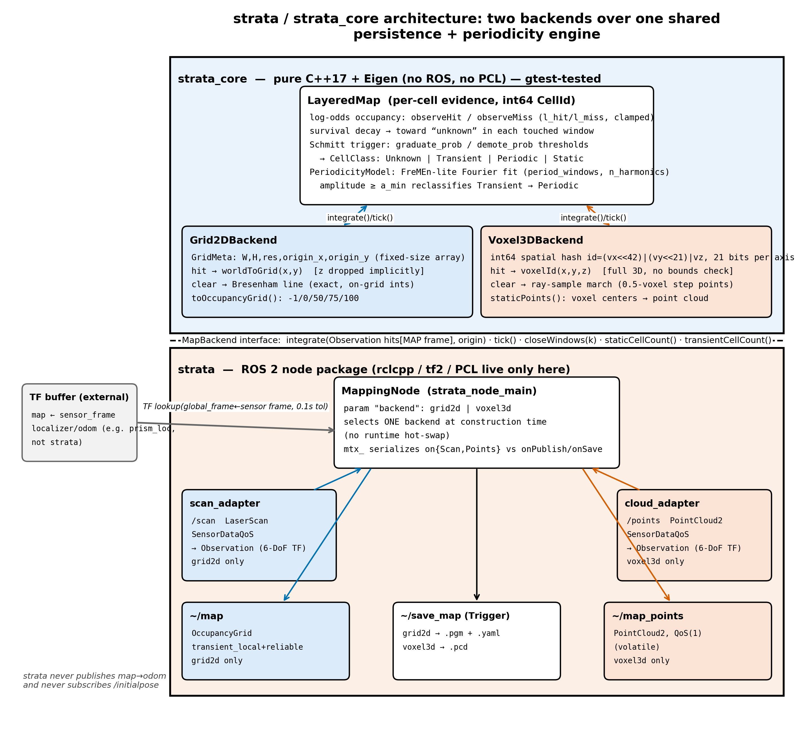
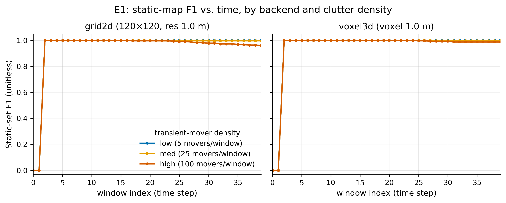
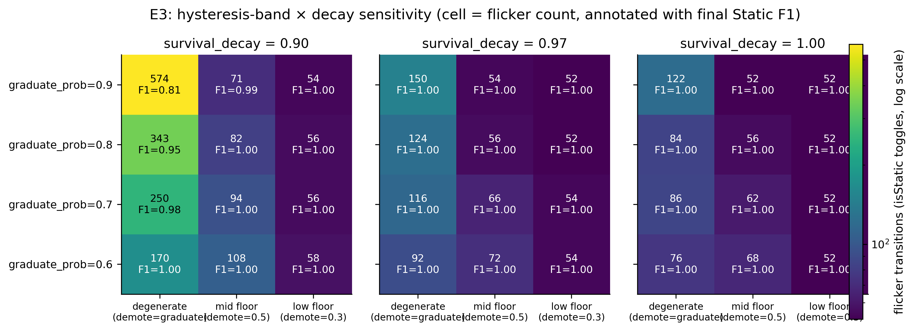

<div align="center">

# STRATA

**One geometry-free persistence-and-periodicity engine, two pluggable LiDAR
backends (2D occupancy grid or 3D voxel), for lifelong mapping in ROS 2 Humble —
pick a backend with one parameter and get a durable static map plus periodic and
transient layers, at full 6-DoF.**

[](https://github.com/kjungmo/strata/actions/workflows/ci.yml)
[](LICENSE)

[](paper/strata_paper.pdf)
[](https://doi.org/10.20944/preprints202610.2339.v1)
[](https://github.com/sponsors/kjungmo)

[Overview](#overview) · [Paper](#-paper) · [Install](#-prerequisites) ·
[Quick start](#-quick-start) · [Evaluation](#-evaluation) · [Docs](#-documentation) · [Roadmap](#-roadmap)



</div>

`strata` incrementally builds and maintains a robot map from EITHER a **2D
LiDAR** (`LaserScan` → `OccupancyGrid`) OR a **3D LiDAR** (`PointCloud2` → voxel
cloud), backend chosen by one parameter. A single Bayesian-persistence engine
copes with dynamic AND semi-static environments: it **graduates** durably
occupied cells into a permanent static map, flags **periodically** occupied
cells (FreMEn) instead of baking them in, and lets **transient** observations
fade. Sensor poses are full 6-DoF.

> **`strata` is not a SLAM system.** It does not estimate the robot's pose. It
> consumes an external pose source via TF (`map → sensor`) — e.g. the sibling
> [`prism_loc`](https://github.com/kjungmo/prism_loc) localizer or a plain
> `odom → base_link` chain — and maps against it. Drift in that pose source
> corrupts the map; there is no correction here.

## 📢 News
- **2026-10** — Preprint posted on Preprints.org (version 1, not peer
  reviewed): [doi:10.20944/preprints202610.2339.v1](https://doi.org/10.20944/preprints202610.2339.v1).
- **2026-10** — **Version 0.2.0, behaviour change** (branch `v2/evidence-sprt`, not yet
  merged or released): cells now graduate by a **sequential probability ratio test**
  (`evidence_model: sprt`, the new default) instead of the v0.1 log-odds rule. You state
  `m0`, `m1`, `alpha` and `beta`; the increments and thresholds are derived
  ([`SPEC.md` §3.2a](SPEC.md)). What changes for an existing user:
  an always-hit wall graduates after **4** windows, not 3, and never earlier; a cell can be
  rejected or read out `Intermittent`; the 3D defaults are **not calibrated for 3D**.
  To get the v0.1 behaviour, set `evidence_model: "legacy"` (the nine v0.1 keys `l_hit` to
  `prune_prob` are read only then). **C++ library users:** rebuild against 0.2.0 (`MapBackend`, `LayeredMapParams` and `LayeredMap` change layout); `LayeredMapParams{}` now defaults to `EvidenceModel::Sprt`, so set `evidence_model = EvidenceModel::Legacy` explicitly if you set the v0.1 keys, or they are ignored; and handle the new `CellClass::Intermittent` in your `switch` ([`SPEC.md` §5](SPEC.md)). The defaults `m0 = 0.20`, `m1 = 0.70` were measured on one 2D
  dataset and are provisional until the calibration is frozen
  (`paper/experiments/realdata/PREREG.md`). The paper (`paper/arxiv_ref`) is pinned to
  `708d62f` (the code of this release). It reports the synthetic suite in two arms (the
  legacy v0.1 arm and the sprt arm, with E7 for the sequential test), a calibration of the
  pair on real data that did not freeze (the 2D pair is provisional, the 3D pair is not
  calibrated), and an evaluation of seven evidence rules on four public datasets that
  picks no winner. The real-data numbers come from an offline harness with reference poses,
  not from the ROS node, and Periodic is validated on synthetic streams only. The sprt arm
  of E0–E6 and E7 are committed under `paper/experiments/results/*_sprt.csv` and `e7_*.csv`.
- **2026-10** — Paper and repository audited for submission: the first version of the
  manuscript described the code of commit `312b09c`; the manuscript now
  describes `708d62f` (see the entry above). Since the first release the periodicity test was corrected (centred
  amplitude, calibrated significance, level spent over repeated read-outs) and
  the node gained time-based windows, input diagnostics and a verified map save.
  The package version string was still `0.1.0` then.
- **2026-07** — **v0.1.0 public release** (commit `a82f935`): the `strata_core`
  engine + both backends, the paper and the seeded reproduction harness.

## Overview

One `LayeredMap` persistence core (per-cell evidence graduated by a sequential
test, or by the v0.1 log-odds rule with survival decay and Schmitt-trigger
hysteresis) and one `PeriodicityModel` (FreMEn-lite) drive
**both** backends behind a `MapBackend` interface — the classifier that
graduates, demotes, prunes, and periodicity-labels every cell is shared by
composition, not duplicated per dimension. The two backends are the two sensor
paths a ground robot actually has:

| | **grid2d** | **voxel3d** |
|---|---|---|
| Input topic / msg | `/scan` (`sensor_msgs/LaserScan`) | `/points` (`sensor_msgs/PointCloud2`) |
| Map output | `nav_msgs/OccupancyGrid` | `PointCloud2` / PCD |
| Geometry & projection | 2D occupancy grid; 6-DoF endpoints projected onto the plane (z dropped) | fully volumetric voxel-hash (x, y, z kept) |
| Ray clearing | Bresenham ray-trace | ray-sample along the beam |

> **Evidence defaults (0.2.0).** Both backends graduate a cell with the sequential test of
> [`SPEC.md` §3.2a](SPEC.md) at `m0 = 0.20`, `m1 = 0.70`, `alpha = beta = 0.01`. The pair was measured on one
> 2D scanner dataset (0.05 m, 1.0 s windows) and is provisional. **`voxel3d` uses the same pair and it is *not*
> calibrated for 3D**: on single-pass driving data most structure voxels stay undecided (on KITTI 00
> structure voxels are touched in a median of 4 windows). The node logs this at start and shows it on `/diagnostics` (`<node>: evidence model`). Re-derive
> `m0` and `m1` for your sensor, window length and resolution with `paper/experiments/realdata/hitrate_probe`.

**Why "STRATA".** Like geological **strata**, the map is built from layers of
observation that accumulate over time. Durable layers — seen again and again —
consolidate into the permanent **static** map; **periodic** layers (a door open
by day, shut by night) are recognized as recurring rather than baked in; and
**transient** layers erode away.

**Design principle.** The map engine is pure C++17 + Eigen, keyed by an integer
cell id, and is unit-tested with gtest **without ROS or PCL** (114 gtest cases across 12
suites, plus 71 node tests). rclcpp, tf2, and PCL live only in the ROS node
package. Because persistence, hysteresis, and periodicity are implemented once,
the behavior is identical across the 2D and 3D backends.

<details>
<summary>Text architecture diagram (the hero figure above, as ASCII)</summary>

```
strata_core   (pure C++17 + Eigen, no ROS / no PCL, gtest-tested):

  LayeredMap  ── THE HEART ──────────────────────────────────────────
    evidence_model = sprt (default): increments from (m0, m1, alpha, beta),
      graduate at l >= A, cap, reverse-test demotion, reject at n >= T,
      else Undecided (read out Transient / Intermittent)          ─► Static
    evidence_model = legacy: log-odds (l_hit/l_miss + clamp), survival
      decay, Schmitt trigger graduate(graduate_prob) / demote(demote_prob)
        │                                                              │
        └─► PeriodicityModel (FreMEn-lite, incremental Fourier)     ─► Periodic
                amplitude >= periodic_amplitude_min AND                else Transient
                Chernoff false-alarm bound <= periodic_false_alarm,
                spent over the touch count (alpha spending)

  MapBackend  (interface: integrate(obs, sensor_origin) / tick() / closeWindows(k))
    ├─ Grid2DBackend   6-DoF hits projected to a 2D plane, Bresenham ray clearing
    └─ Voxel3DBackend  fully volumetric voxel-hash, ray-sample clearing

ROS 2 node   (rclcpp / tf2 / PCL here only):

  strata  ── MappingNode ──  backend = grid2d | voxel3d
    in :  /scan | /points ,  TF (map -> sensor, full 6-DoF)
    out:  ~/map (OccupancyGrid) | ~/map_points (PointCloud2) ,  ~/save_map (Trigger)
```

</details>

See [`SPEC.md`](SPEC.md) for the full design (algorithm, parameters, frames, and test strategy).

## 📄 Paper

> **STRATA: One Geometry-Free Persistence-and-Periodicity Engine for
> Selectable 2D/3D Lifelong LiDAR Mapping**
> · [Preprint (Preprints.org, v1)](https://doi.org/10.20944/preprints202610.2339.v1)
> · [PDF](paper/strata_paper.pdf) · [LaTeX source](paper/arxiv_ref/)
> · [Markdown](paper/strata_paper.md) · [한국어](paper/strata_paper_KR.md)

The manuscript is a preprint and has not been peer reviewed. It documents the
architecture, the persistence and periodicity model, the seeded synthetic
characterization suite (calibration E0, experiments E1–E7, in a legacy and a sprt arm),
a calibration of the shipped pair on real LiDAR data (not frozen) and a held-out
evaluation of seven evidence rules on four public datasets, and it describes the
code of commit `708d62f` (tag `paper-v2`); the first release of the manuscript is commit `312b09c`. If you use `strata` in academic work, please cite:

```bibtex
@article{kang2026strata,
  author  = {Kang, Jungmo},
  title   = {{STRATA}: One Geometry-Free Persistence-and-Periodicity Engine
             for Selectable {2D/3D} Lifelong {LiDAR} Mapping},
  journal = {Preprints},
  year    = {2026},
  doi     = {10.20944/preprints202610.2339.v1},
  url     = {https://doi.org/10.20944/preprints202610.2339.v1},
  note    = {Preprint, version 1, not peer reviewed. Source and code at
             \url{https://github.com/kjungmo/strata}},
}
```

A machine-readable [`CITATION.cff`](CITATION.cff) mirrors this citation.

## ⚙️ Prerequisites

- **ROS 2 Humble**, **C++17**, **Apache-2.0**. No proprietary dependencies.
- **`strata_core`** builds and unit-tests with the plain system toolchain — it
  needs only a **C++17** compiler + **Eigen3** + **gtest**, no rclcpp and no
  PCL.
- The **`strata`** ROS 2 package additionally needs **rclcpp**, **tf2**, and
  **PCL** (RoboStack/conda Humble works too — run the build inside the
  activated env).

## 🚀 Quick start

```bash
# 1. Map engine — build & test with the plain system toolchain (no ROS):
cmake -S strata_core -B build/core -DSTRATA_CORE_BUILD_TESTS=ON
cmake --build build/core -j && ( cd build/core && ctest --output-on-failure )

# 2. Full ROS 2 Humble build & test (workspace):
#    place this repo at <ws>/src/strata, then from <ws>:
colcon build --symlink-install
source install/setup.bash
colcon test --packages-select strata      # the 71 node gtests; the 114 engine
colcon test-result --verbose              # gtests run in step 1, not under colcon
#    (RoboStack/conda Humble users: run the above inside your activated env.)

# 3. Run — 2D occupancy-grid mapping (add rviz:=false on a machine without a display):
ros2 launch strata grid2d.launch.py
#    3D voxel mapping:
ros2 launch strata voxel3d.launch.py
#    save the current map (PGM+YAML for grid2d, static voxels as PCD for voxel3d):
ros2 service call /strata/save_map std_srvs/srv/Trigger
#    check a saved grid2d pair (default save_path /tmp/strata_2d):
ros2 run strata check_saved_map.py /tmp/strata_2d.yaml
```

A pose source must already be publishing TF from `global_frame` (default `map`)
to the LiDAR's frame. Run `prism_loc` (or any localizer / odometry chain) first.

**No robot at hand?** Feed the node the synthetic scene that CI uses (a wall, a
periodic door and a moving object, with its own `/clock` and TF):

```bash
# terminal 1
ros2 launch strata grid2d.launch.py rviz:=false use_sim_time:=true
# terminal 2, from <ws>: prints one ok/FAIL line per check, calls ~/save_map, ends with PASS
python3 src/strata/scripts/synthetic_e2e.py grid2d install/strata/share/strata/params/grid2d.yaml
ros2 run strata check_saved_map.py /tmp/strata_2d.yaml      # OK: ... (exit 0)
# terminal 3, while the script of terminal 2 is still sending (about 75 s):
ros2 topic echo /diagnostics --once                         # the input-rate status, level OK
python3 src/strata/scripts/rate_report.py --seconds 30
```

Once the script has ended, `/diagnostics` turns ERROR with `no input on /scan for
... s` after `input_timeout_s`: that is the intended report of a stopped sensor.

This sequence was run from a fresh clone on Humble (RoboStack, GCC 14.3) for the
paper audit of 2026-10-12. Build and CI cover ROS 2 Humble only.

## 📊 Evaluation

**Scope: the numbers below are a seeded synthetic characterization suite (the
legacy v0.1 arm, E0–E6), not a field dataset.** Every one comes from a deterministic
`strata_core` harness: no real sensor, no robot motion and no field deployment enters
it, and no external baseline is run. The 0.2.0 paper adds the sprt arm and E7 on the same
harness, and a real-data part: a calibration of the pair on LILocBench, Oxford Spires
and the KTH benchmark (pre-registered, amended after its first measurement, not frozen;
the 2D pair is provisional and the 3D pair is not calibrated) and a held-out evaluation
of seven evidence rules on LILocBench, Oxford Spires, the KTH benchmark and Boreas.
Those runs use an offline harness with reference poses, not the ROS node, and pick no
winner; the OctoMap and ELite rows apply their increments once per touched window and
are not the published methods. Periodic is validated on synthetic streams only. E1–E4
are single-seed point estimates (seed `12345`) with no cross-seed variance
characterized, so they illustrate a mechanism rather than a distributional performance
claim; E5 and E6 are multi-seed. `strata` itself performs no SLAM.

<table>
<tr>
<td width="50%" valign="top">



**E1 — static-map quality.** (E0–E6 ran with `evidence_model = legacy`, the v0.1
arithmetic, which the harness names explicitly; with the 0.2.0 default the same wall
graduates at window 4: `results/e1_static_quality_sprt.csv`, recall 1.0 from window 4
and no false Static cell in any of the six runs.) Under the legacy rule both backends
graduate the 161-cell static wall by **window 3** and hold **recall 1.0** thereafter. The only map-quality divergence
is a clutter-induced static-precision gap of **0.9253 (grid2d) vs. 0.9758
(voxel3d)** at 100 movers/window — and it arises in the backends' native
sampling, not in the shared classifier.

</td>
<td width="50%" valign="top">



**E3 — hysteresis is the dominant stabilizer.** Removing the hysteresis band
(degenerate config) inflates flicker from **54** toggles at **F1 1.000** to
**574** toggles at **F1 0.810** on identical replayed noise. The band alone
suppresses the flicker.

</td>
</tr>
</table>

E4 estimates a flat **56 B/cell** footprint (periodicity off): `voxel3d` holds
**4.4–10.0×** as many live cells as `grid2d` at equal extent, and `grid2d` is the
cheaper backend per `integrate()` call by **7.7–10.4×** over three recordings on a quiet
host (one machine; the timings are not portable, `paper/experiments/results/e4_recordings/`). E2 detects
50%-duty periodic doors at true-positive rate **2/3** (from 25 windows on)
with no false positive on Bernoulli clutter at any read-out length from 8 to
100 windows. The periodicity test is noise-calibrated and spends its level over
repeated read-outs: over 1024-window runs on held-out seeds (E5), at most
**2 of 2000** Bernoulli clutter cells are ever labelled Periodic, against up to
953 of 2000 with a constant level. The test has known limits: its null is iid
clutter, so slowly switching (temporally correlated) clutter is labelled
Periodic at the shipped period (1908 of 2000 cells in E5).

**Known defect of the v0.1 parameters, and what 0.2.0 does about it.** The dominant
labelling error is a false Static label. With the v0.1 defaults (the legacy arm, not
the 0.2.0 default), 1960 of 2000 random clutter cells that are occupied in half of
their windows end Static after 64 windows (E6, `results/e6_confusion.csv`): the
graduation rule labels a cell Static when it is occupied in more than roughly 0.354 (about a third) of
the windows in which it is observed, and it cannot tell such clutter from a noisy wall
of similar occupancy. `l_miss` and `survival_decay` move that threshold (paper, the
remark "Which occupancy rates graduate" and the E6 table). The 0.2.0 default is the
sequential test, and 1120 of the same 2000 cells end Static (`results/e6_confusion_sprt.csv`):
a hit rate of 0.5 lies between `m0` and `m1`, where the test promises nothing. The pair
`(0.20, 0.70)` is provisional (the calibration did not freeze) and is not calibrated
for 3D.

Full setup, all tables and the limitations are in the
[paper](paper/strata_paper.pdf) §4–§5. Reproduce end-to-end with
[`paper/experiments/run_all.sh`](paper/experiments/run_all.sh) (see
[`paper/README.md`](paper/README.md)); every number quoted in the manuscript is checked in CI by
[`paper/experiments/number_guard.py`](paper/experiments/number_guard.py)
against the committed CSVs in `paper/experiments/results/` (the numbers in this README are not; see the P5 re-sync list in [`paper/README.md`](paper/README.md)).

The ROS path is checked separately on Humble in CI:
[`scripts/synthetic_e2e.py`](scripts/synthetic_e2e.py) feeds each launched node a
synthetic wall, periodic door and moving object over its real topics and TF, and
checks that the published map keeps the wall static, labels the door periodic
(grid2d) or keeps it out of the static map (voxel3d), never makes the moving
object static, renders cleared space free (grid2d), and that `~/save_map` writes
a file. For grid2d it then loads the saved PGM + YAML in `nav2_map_server` and
checks the map it serves against the last published `/strata/map` (see below).
That check needs Nav2's map server (`apt install ros-humble-nav2-map-server`);
to rerun it, start `ros2 launch strata grid2d.launch.py rviz:=false
use_sim_time:=true` and run `python3 scripts/synthetic_e2e.py grid2d
<params.yaml> --check-map-server` with the params file the node was launched
with.

## ⚠️ Deployment cautions

What the paper measured and what it could not, in the form a deployer needs (paper §7–§8;
every number below is checked against the manuscript by `number_guard.py`):

- **Memory.** In `voxel3d` memory grows with the cells touched; Undecided cells are kept and
  nothing is forgotten out of view, so over a lifelong run it is unbounded. The shipped 3D file
  turns the Periodic veto on, and the veto costs memory: on 2,582,017 cells the peak was 221 MB
  with the veto off and 1,212 MB with it on (a probe on ten frames of one Boreas session). At 0.1 m
  with the veto on, all 14 runs that were started ran out of memory at the 9 GB limit of the harness.
  The node crops no range (it drops only non-finite points): crop the cloud before the node.
  `grid2d` is bounded by its fixed grid. The shipped grid covers 20 m by 20 m (400 by 400 cells of
  0.05 m from the origin (-10, -10)); endpoints outside it are dropped silently, and a sensor outside
  it clears nothing while its in-grid hits still count. Size the grid and its origin to the site.
- **Walls become Static late.** On LILocBench wall runs a Static cell appears after a median of 33
  windows (upper decile 156; one window is one second), and 14.21 % of the wall cells are not Static at
  the end. On a single Spires pass up to 22.50 % of the non-ground structure ends Undecided.
  A Static cell stays 100 until at least 5 all-miss touched windows have passed, and a cell no ray
  re-observes stays 100 indefinitely, so a removed obstacle can stay lethal for a long time.
- **Do not use this map as the only source of obstacles.** Only Static is drawn 100 on `~/map`
  (a cell hit in the open window or last observed as a hit, and a Transient or Intermittent cell that
  leans occupied, read 50; Periodic reads 75; every other cell reads 0 if it was last observed free and
  -1 otherwise). Nav2's `StaticLayer` subscribes to `map` by default: set its `map_topic` to `~/map` or
  remap it. With the default `trinary_costmap` true and `lethal_cost_threshold` 100, only 100 is lethal;
  50 and 75 read as free space, and so does -1 when `track_unknown_space` is false (the costmap
  default). A map saved with `~/save_map` and served by `nav2_map_server` reads every cell drawn 50 or 75 as
  unknown, so a planner allowed to plan through unknown space plans through them.
- **The error rates are per first test of a history, under independent windows.** Since the pin the status text of the
  node and the comments of the shipped parameter files state that scope.
  On real 2D clutter the realised per-cell rates are above `alpha` (paper §7.2), and the windows of a cell are
  correlated. Periodic is validated on synthetic streams only; the `(0.20, 0.70)` pair is provisional and
  not calibrated for 3D. The real-data numbers come from an offline harness with reference poses, so TF
  latency, transport loss, localiser error and stamp offsets are in none of them.
- **Windows.** The shipped parameter files use one-second time windows; the code defaults of the node are
  scan windows (`window_mode` `scans`, `layer_interval` 10), for which the pair is not calibrated.

## 🔌 Interface

| | **grid2d** | **voxel3d** |
|---|---|---|
| Input topic | `/scan` (`LaserScan`) | `/points` (`PointCloud2`) |
| Pose input | TF `map → sensor` (full 6-DoF), looked up at the message stamp | TF `map → sensor` (full 6-DoF), looked up at the message stamp |
| Map output | `~/map` (`OccupancyGrid`, `transient_local`) | `~/map_points` (`PointCloud2`) |
| Save service | `~/save_map` (`std_srvs/srv/Trigger`) → PGM + map_server YAML | `~/save_map` (`std_srvs/srv/Trigger`) → PCD |
| Diagnostics | `/diagnostics` (`DiagnosticArray`), one input-rate status per second | same |

There is **no** `/initialpose` input and **no** `map→odom` output — `strata`
maps, it does not localize. The robot's pose comes in via TF from an external
source. Occupancy values render as static→100, periodic→75, transient→50
(last observed as a hit, or live evidence leaning occupied), free→0,
unknown→-1. Free means last observed free, not currently free: a cell a ray has
cleared reads 0, even after the classifier prunes it, while its last
observation was free. It is not re-verified out of view, so an obstacle placed
where the sensor no longer looks reads free until it is observed; do not treat
0 as clearance outside the current sensor footprint. A saved PGM writes free
as 254, transient and periodic as 100 and static as 0, so with the thresholds
written beside it (`occupied_thresh 0.65`, `free_thresh 0.196`)
`nav2_map_server` reads free cells as free, static cells as occupied, and
transient and periodic cells as unknown. The YAML names the image by file
name (single-quoted), which map_server resolves next to the YAML (as Nav2's
map_saver writes it), so the pair can be copied to a robot as is, and it writes
resolution and origin with as many digits as a double needs to read back
exactly, in the "C" locale whatever the process locale. Both files are written
to `.tmp` names and flushed to disk before they are renamed, so a save that
fails before the renames leaves the previous pair untouched (voxel3d's PCD
likewise). The PGM is renamed first and the YAML second, so a crash or failure
between the two renames can pair the new PGM with the previous YAML
(map_server takes the image name from the YAML, so no rename order avoids this
with fixed names); the directory is fsynced after the renames. So that such a
pair can be detected, the YAML records the image it was written for, in two
extra keys computed over the exact PGM bytes: `strata_image_bytes` (the file
size) and `strata_image_sha256` (64 hex digits, single-quoted).
`nav2_map_server` ignores both keys and does **not** check them: it loads a
mismatched pair without complaint, with the previous resolution and origin.
Run [`check_saved_map.py`](strata/scripts/check_saved_map.py) (see below)
before trusting a saved pair after an unclean shutdown or a failed `save_map`.
`save_map` answers `success: false` with the path and the reason when a file
cannot be written (for example a missing directory) or when `save_path` has no
file name (empty or ending in `/`). That map_server loads the YAML with the two
extra keys is verified in CI on Humble only; no Jazzy job exists. One manual
load in Jazzy's `nav2_map_server` 1.3.11 succeeded; the script, the pair and the
recorded output are in
[`paper/deploy_checks/jazzy_map_server/`](paper/deploy_checks/jazzy_map_server/). CI checks this
round trip on Humble on the synthetic scene (`synthetic_e2e.py --check-map-server`): it moves the
saved pair to a fresh directory, loads the YAML there in `nav2_map_server`,
brings it active, and requires the served map to have the published width and
height, resolution and origin within 1e-9 (on a grid origin of
-10.000001234567891, -9.999998765432109 that six significant digits cannot
hold), and every one of the 160 000 cells to map 0→0, 100→100, 50/75/-1→-1,
with only -1, 0 and 100 served. The synthetic scene's final map holds free,
static, periodic and unknown cells but no transient (50) cell, which shares the
periodic shade in the PGM.

**Checking a saved pair.** The checker is installed with the package:

```bash
ros2 run strata check_saved_map.py map.yaml
# nav2_map_server does not check the keys, so gate the launch on the checker:
ros2 run strata check_saved_map.py map.yaml && ros2 launch nav2_bringup bringup_launch.py map:=map.yaml
```

It needs only the Python standard library (no ROS, no PyYAML). On a machine
without the package, copy
[`strata/scripts/check_saved_map.py`](strata/scripts/check_saved_map.py) there
and run `python3 check_saved_map.py map.yaml`. It finds the image as map_server
does (a relative `image:` is next to the YAML), compares its size and SHA-256
with the YAML's two keys, requires a binary PGM (`P5`) whose width × height is
exactly its pixel payload (maxval 1..65535), a finite `resolution` > 0 and an
`origin` of three finite numbers, and prints one line (after a non-zero exit
`ros2 run` adds its own `[ros2run]: Process exited with failure N` line):

| Exit status | Line starts with | Meaning |
|---|---|---|
| 0 | `OK:` | the image is the one this YAML was saved with, and both files are well formed |
| 1 | `FAIL:` | do not use the pair: `image does not match this YAML: interrupted save, or the image was edited or replaced`, or a file is missing, unreadable or not a regular file, or the YAML or the PGM is malformed, or the image is not a binary PGM (a PNG, BMP or ASCII `P2` image fails here, with or without the keys) |
| 2 | (usage) | wrong command line |
| 3 | `UNVERIFIABLE:` | the YAML has neither key (saved by an older version or another tool) and the image is a well-formed binary PGM (`P5`): nothing ties this image to this YAML |

Treat anything but 0 as "not verified". On a mismatch, call `~/save_map` again
(a completed save rewrites both files) or restore both files from the same
backup.

**Any edit of the image fails by design.** Cleaning a map up in an image editor
changes the PGM bytes, so the checker reports a mismatch. After an intended
edit, do one of these:

1. Delete both `strata_image_*` lines from the YAML. The pair is then
   `UNVERIFIABLE` (exit 3).
2. Rewrite both keys from the edited file: `strata_image_bytes` from
   `stat -c %s map.pgm`, and `strata_image_sha256` (single-quoted) from the
   first field of `sha256sum map.pgm`.

The keys tie the YAML to the image bytes only: two saves whose images
are byte-identical (the same cells saved again under a different
`grid_origin_*`, say) cannot be told apart. They detect a mixed-up or damaged
pair, not tampering: whoever can rewrite the image can rewrite the YAML. The
node does not run this check itself and nothing in Nav2 does; `verifyMapPair`
in [`map_writer.hpp`](strata/include/strata/map_writer.hpp) is the same
comparison in C++ for a caller that wants it: it reads a hand-edited YAML by
the checker's rules (quoting, comments, blanks after the colon, leading zeros
in the byte count, upper-case hex; a key given twice is refused), and its
gtests run the checker on every such YAML and expect the same verdict. CI runs the checker on the pair
the round-trip scenario saved (which map_server has just loaded, so the extra
keys are harmless to it), on that YAML beside an image with one pixel changed
and beside an image of another size (both exit 1), on the edited image with the
keys rewritten from `stat` and `sha256sum` (exit 0), on the YAML with CRLF line
ends (exit 0), on the YAML with the keys removed (exit 3), and on malformed
files, a directory or PNG as the image, and over-long digit runs (exit 1).

**Input rate.** A window is either `layer_interval` integrated scans
(`window_mode: "scans"`, the engine rule and the code default) or
`window_period_s` of message time (`"time"`, what the shipped parameter files
select). Scan windows stretch when scans are lost on the best-effort link,
dropped for missing TF or skipped by an overloaded node, which detunes the
periodicity test: in the synthetic check, losing 40 % of the scans turns the
tested door cells static (at least 95 %, none periodic) with scan windows
(grid2d), while time windows keep the door periodic in grid2d and out of the
static map in voxel3d; CI checks all three. Time windows need sane stamps:
header stamps on the same clock as TF and increasing; zero stamps are dropped. With time windows the periodic test's
period is `period_windows` × `window_period_s` seconds (24 × 1.0 s shipped)
whatever the sensor rate or load: keep a window long enough to hold several
messages per sensor and set `period_windows` from the period you want to detect.
Do not loop a bag into a running node: a re-anchor resets only the clock, so the
evidence gathered across the loop is not independent; restart the node instead.

Launch with `use_sim_time:=false` (the default) on a live robot and
`use_sim_time:=true` when replaying a bag with `--clock` (a paused bag reads as
"no input" after `input_timeout_s`). The TF lookup at each message stamp waits
for a transform that is slightly late: 0.1 s of ROS time, capped at 1 s of
steady time; a clock unchanged for 1 s is treated as frozen and no longer
waited on (the callback where it stops can wait up to the cap). So a slowed
bag or simulator gets the same tolerance as a live robot at playback rates
down to 0.1x (below that the cap shortens it), a coarse sim clock that steps
less often than every 0.1 s of wall time is still waited on, as long as it
steps at least once per second of wall time; a sparser clock counts as frozen
(when it steps past the budget, the lookup is retried for 20 ms more of steady
time, for a transform published with that step), and `use_sim_time:=true` without `/clock`
cannot hang the node. A failed lookup
holds the sensor callback for up to that long, and the message is dropped.
Without `/clock` the node keeps answering services and publishing
diagnostics, and after 3 s of an unchanged clock with messages arriving warns
that the ROS clock is not advancing (the same observation of the last clock
change drives both). CI checks this: it starts `ros2 launch strata
grid2d.launch.py rviz:=false use_sim_time:=true`, then runs `python3
scripts/check_sim_clock_stall.py`, which publishes scans but no `/clock` and no
TF; and, on a fresh launch, `python3 scripts/check_coarse_clock.py`, which runs
a sim clock at 0.5x in 0.1 s steps (one every 0.2 s of wall time) with each
scan stamped 30 ms ahead of the transform it needs, and requires no TF failure.

Once a second the node publishes a `<node>: input rate` status on
`/diagnostics`: input rate, estimated lost share, TF failures, window duration
and the periodic period in seconds. It warns when scan windows lose more than
`rate_warn_drop_fraction` or jitter, when time windows go empty or thin, when
stamps are zero or stop advancing, when `use_sim_time` is true and the ROS
clock has stood still for 3 s while messages arrive (no `/clock`), or when
messages arrive but the TF lookup fails (no localizer yet), and turns ERROR
after `input_timeout_s` without input (`startup_timeout_s` before the first
message).

Every status, from the first one, also carries `messages_received_total`,
`messages_integrated_total`, `tf_failures_total`, `tf_failures_since_integrate`
(the running streak, `0` again once a message integrates),
`seconds_since_last_integrate` and `last_tf_error` (the tf2 text of the last
failed lookup as one line of at most 120 bytes while the streak runs, empty
otherwise). When messages arrive but cannot be placed, the level stays OK until
`startup_timeout_s` (30 s) has passed since start and is WARN after it, as
before, but the message is no longer `ok`: it reads `no usable TF map ->
<frame> yet: N message(s) received on /scan, 0 integrated, N TF lookup(s)
failed (WARN after startup_timeout_s = 30 s)`, with the `frame_id` of the
message that failed. That is true without a localizer, with a transform that is
too old for the stamp and with a wrong frame alike; `last_tf_error` says which.
If lookups start failing in mid-run, the message names it once nothing has
integrated for 1 s (`TF lookup map -> <frame> failing: ...`; with input at 2 Hz
or slower that is already after one failed lookup) and the level turns ERROR
after `input_timeout_s`. The states, levels and messages are tabulated in
[SPEC.md](SPEC.md) ("Input states on `/diagnostics`"); CI walks both backends
through them on Humble with
[`scripts/check_no_localizer.py`](scripts/check_no_localizer.py).

The loss is estimated per
sensor frame from gaps between stamps and is unreliable above about 80 % loss,
so set `expected_scan_rate_hz` (per sensor) from the datasheet or
`ros2 topic hz`.

On a robot, run the node on real input and summarise its diagnostics:

```bash
python3 scripts/rate_report.py --seconds 600 --params <your params.yaml>
```

It prints the measured rates and loss and suggests `expected_scan_rate_hz`,
`window_period_s` and, with `--target-period-s`, `period_windows`.

See [`SPEC.md`](SPEC.md) §2 for the full I/O contract and REP-105 frame conventions.

## 📚 Documentation

| Document | Contents |
|---|---|
| [`paper/strata_paper.pdf`](paper/strata_paper.pdf) | The manuscript (built from [`paper/arxiv_ref/`](paper/arxiv_ref/), the LaTeX master) |
| [`paper/strata_paper.md`](paper/strata_paper.md) | Markdown rendering of the manuscript (EN), generated from the LaTeX master by `paper/arxiv_ref/tools/tex2md.py`; same text, numbers and claims |
| [`paper/strata_paper_KR.md`](paper/strata_paper_KR.md) | Korean translation of that rendering |
| [`paper/README.md`](paper/README.md) | What is where under `paper/`, the code pin, how to reproduce |
| [`SPEC.md`](SPEC.md) | Design spec — algorithm, parameters, frames, module layout, test strategy |
| [`paper/experiments/`](paper/experiments/) | Reproduction harness (E0 calibration, E1–E7) + `run_all.sh` + `number_guard.py` |
| [`paper/figures/README.md`](paper/figures/README.md) | Figure design notes and CSV sources |

## 🗺️ Roadmap

The current code ships one Bayesian-persistence engine (log-odds occupancy + Schmitt-trigger
graduation to a static layer + FreMEn periodicity classification), full 6-DoF
sensor poses, and two backends: a 2D occupancy grid and a 3D voxel map. Named
next steps, drawn from `SPEC.md` §8 and the paper's future-work section:

- [ ] **TSDF surface backend** — replace the voxel-hash with a signed-distance surface
- [ ] **Multi-session map merge** — combine maps built across separate runs
- [ ] **Loop closure** — rebase the map on an external pose graph (`strata` consumes pose; it does not close loops itself)
- [ ] **Pluginlib-style dynamic backend loading** — once the backend count outgrows the current one-parameter `if`/`else`
- [ ] **Real-robot and multi-session field validation** — field and real-robot validation
- [ ] **Learned per-cell ephemerality** — a per-cell-learned decay rate replacing the global `survival_decay` scalar

## 🙏 Acknowledgements

`strata` stands on a line of published work:

- **FreMEn** — Krajník et al., *FreMEn: Frequency Map Enhancement for Long-Term Mobile Robot Autonomy in Changing Environments* (IEEE T-RO 2017) — the incremental-Fourier periodicity model; its spatio-temporal occupancy grid (Krajník et al., IROS 2016) is the closest prior work.
- **Persistence Filter** — Rosen, Mason & Leonard, *Towards Lifelong Feature-Based Mapping in Semi-Static Environments* (ICRA 2016) — the survival-decay forgetting model.
- **ELite** (ICRA 2025) and **LT-mapper** (ICRA 2022) — recent LiDAR lifelong-mapping systems that embed persistence logic in full lifelong-SLAM pipelines; `strata` is a small ROS-free engine for that layer only and was not derived from or compared with their code.
- **Removert** (IROS 2020) — motivates the hysteresis band: a Static cell is demoted only after sustained contradicting evidence.
- **Nav2 STVL** (Macenski et al., 2020) and **OctoMap** (Hornung et al., 2013) — lineage for the voxel backend's decaying-occupancy and log-odds-with-clamping cores.
- Sibling project [`prism_loc`](https://github.com/kjungmo/prism_loc) — the intended external pose source that publishes the `map → sensor` TF `strata` maps against.

## 💛 Sponsor

If `strata` saves you time, consider
[sponsoring](https://github.com/sponsors/kjungmo). Sponsorship funds
maintenance, new features, and faster issue response. Backers will be
acknowledged here — thank you.

## License

Apache-2.0. See [`LICENSE`](LICENSE).
