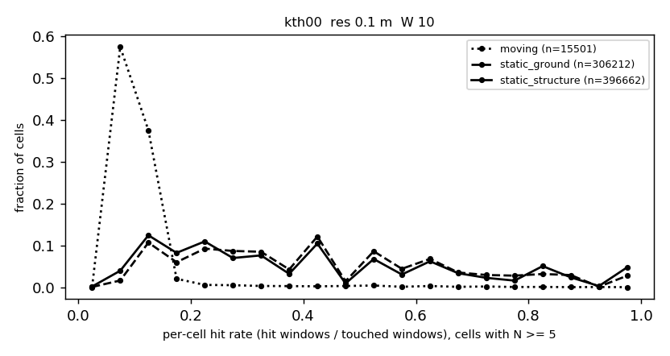
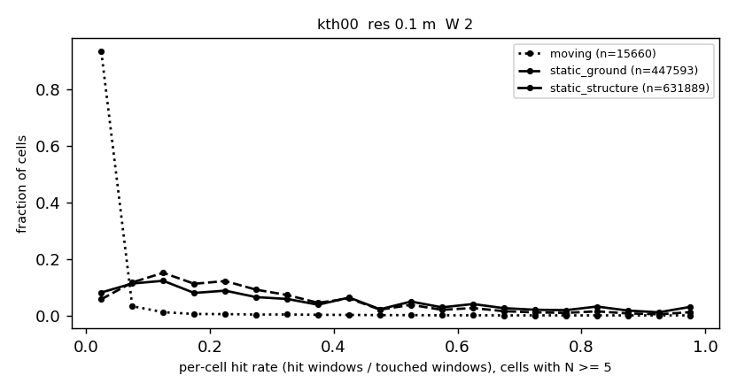
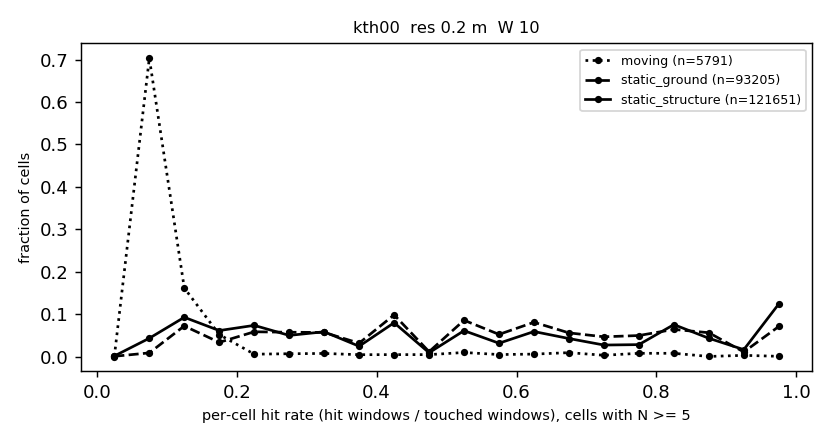
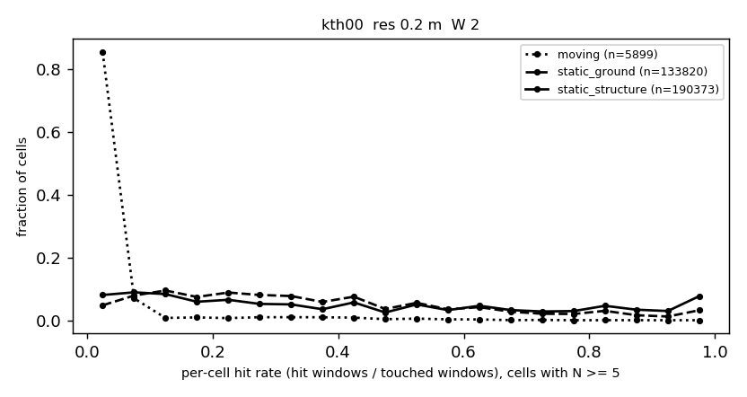
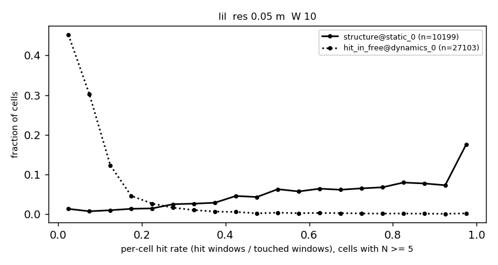
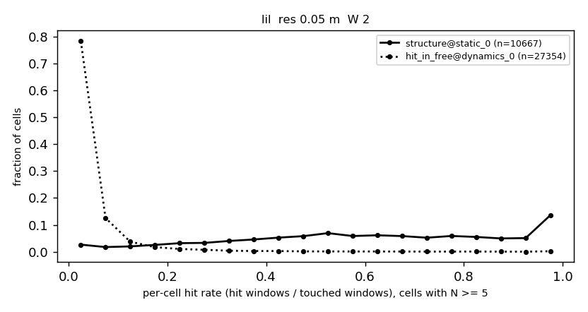
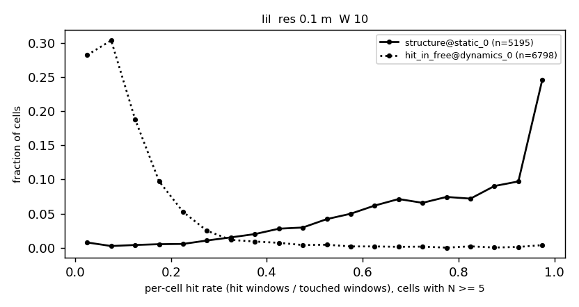
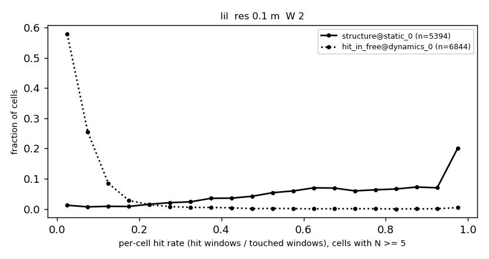

# P1_REPORT: calibration hit-rate statistics (generated)

Generated by `make_report.py` from the files next to it. Definitions: `PREREG_P1.md`. Nothing here chooses `(m0, m1)`; the `gap_ge_0.15` column is a mechanical read-out of the first line of the escalation rule, not a decision.

## Run manifest

```
commit=66bb076b6c07a0c3440526172daa560b5f8873b6
tree_dirty_files=4
host=DESKTOP-KCD7BRS
kernel=6.18.54.1-microsoft-standard-WSL2
cores=12
cpu=AMD Ryzen 5 5500GT with Radeon Graphics
loadavg=4.92 3.20 3.54 8/1173 55331
compiler=c++ (Ubuntu 9.4.0-1ubuntu1~20.04.2) 9.4.0
cmake=cmake version 3.16.3
python=Python 3.8.10
numpy=1.17.4
data_root=/home/cona/datasets/strata
data_inputs_sha256_of_list=f87c70fd87c025468a291f2e1d177c050806d1e519c56d29a2ab47d2a5885fa3
ego_radius_m=3.01
ground_height_m=0.30
kth_resolutions=0.2 0.1
lil_resolutions=0.05 0.10
windows=10 2
```

## Quality gates (pre-registered rule: median <= 0.20 m, p90 <= 0.40 m, >= 500 patches)

| sequence | check | detail | values | values 2 | verdict |
|---|---|---|---|---|---|
| KITTI 00 (poses) | pose_ok=1 | max step 1.223669554 m, max turn 2.410211952 deg |  |  |  |
| KITTI 00 (wall thickness, m) |  | patches 5456 | p10 0.205 p50 0.414 p90 0.781 | p50 = 2.07 cells at 0.2 m | FAIL |
| LIL mapping (wall thickness, m) |  | patches 19283 | p10 0.184 p50 0.376 p90 0.592 | p50 = 7.51 cells at 0.05 m | FAIL |
| LIL mapping (poses) | counts_match=1 | scans dropped 3 of 12180 steps; beams dropped 478 of 19755960 | max GT gap 0.1000053883 s, max GT step 0.04134686708 m | max front/rear skew 0.04201579094 s; tf spread 0/0 |  |
| LIL static_0 (wall thickness, m) |  | patches 19356 | p10 0.196 p50 0.350 p90 0.565 | p50 = 7.00 cells at 0.05 m | FAIL |
| LIL static_0 (poses) | counts_match=1 | scans dropped 1 of 8982 steps; beams dropped 1004 of 14568804 | max GT gap 0.1500022411 s, max GT step 0.05987869633 m | max front/rear skew 0.03115200996 s; tf spread 0/0 |  |
| LIL dynamics_0 (wall thickness, m) |  | patches 19761 | p10 0.233 p50 0.420 p90 0.737 | p50 = 8.39 cells at 0.05 m | FAIL |
| LIL dynamics_0 (poses) | counts_match=1 | scans dropped 0 of 2400 steps; beams dropped 1235 of 3892800 | max GT gap 0.1500008106 s, max GT step 0.06141936645 m | max front/rear skew 0.008367061615 s; tf spread 0/0 |  |

**Gate outcome: 4 of 4 wall-thickness gates failed.** PREREG_P1 section 5: a failing sequence is still run, is reported, and does not enter a headline table. Every sequence failed, so there is no headline table: every number below belongs to an EXCLUDED sequence and is reported only as such.

Consistency rail (`observer_inconsistent = 0`, `window_origin_missing = 0` in every measurement meta file): holds in all measurement runs

## Label counts

| dataset | res_m | moving | static_structure | static_ground | ego (excluded) | GT dynamic points | of which ego |
|---|---|---|---|---|---|---|---|
| KITTI 00 | 0.2 | 5901 | 284672 | 187977 | 4163 | 95983 | 47798 |
| KITTI 00 | 0.1 | 15682 | 978274 | 626867 | 9337 | 95983 | 47798 |

| dataset | res_m | ref occupied | ref free | free near occupied | cells touched |
|---|---|---|---|---|---|
| LILocBench mapping | 0.05 | 11807 | 91945 | 3358 | 140186 |
| LILocBench mapping | 0.1 | 5760 | 20045 | 678 | 35631 |

## q_s, q_c and gap (primary N_min = 5 first; N_min 3 and 10 are sensitivity)

| dataset | res_m | W | pair | N_min | n_structure | n_clutter | q_s_p10 | q_c_p90 | gap | gap_ci95_iid_lo | gap_ci95_iid_hi | gap_ci95_block_lo | gap_ci95_block_hi | gap_ge_0.15 | auc_rate |
|---|---|---|---|---|---|---|---|---|---|---|---|---|---|---|---|
| kth00 | 0.2 | 10 | structure_vs_moving | 3 | 175137 | 5900 | 0.1667 | 0.1818 | -0.0152 | -0.0642 | -0.0152 | -0.1410 | 0.0000 | no | 0.9292 |
| kth00 | 0.2 | 10 | structure_vs_moving | 5 | 121651 | 5791 | 0.1250 | 0.1667 | -0.0417 | -0.0568 | -0.0417 | -0.1071 | -0.0238 | no | 0.9190 |
| kth00 | 0.2 | 10 | structure_vs_moving | 10 | 33716 | 5404 | 0.0833 | 0.1667 | -0.0833 | -0.0985 | -0.0833 | -0.1894 | -0.0758 | no | 0.8518 |
| kth00 | 0.2 | 10 | static_all_vs_moving | 3 | 299860 | 5900 | 0.1667 | 0.1818 | -0.0152 | -0.0660 | -0.0152 | -0.1201 | 0.0000 | no | 0.9357 |
| kth00 | 0.2 | 10 | static_all_vs_moving | 5 | 214856 | 5791 | 0.1429 | 0.1667 | -0.0238 | -0.0390 | -0.0238 | -0.1071 | -0.0128 | no | 0.9303 |
| kth00 | 0.2 | 10 | static_all_vs_moving | 10 | 59932 | 5404 | 0.0909 | 0.1667 | -0.0758 | -0.0909 | -0.0667 | -0.1727 | -0.0667 | no | 0.8881 |
| kth00 | 0.2 | 10 | ground_vs_moving | 3 | 124723 | 5900 | 0.2000 | 0.1818 | 0.0182 | -0.0308 | 0.0182 | -0.1077 | 0.0556 | no | 0.9448 |
| kth00 | 0.2 | 10 | ground_vs_moving | 5 | 93205 | 5791 | 0.1667 | 0.1667 | 0.0000 | -0.0152 | 0.0000 | -0.0837 | 0.0333 | no | 0.9450 |
| kth00 | 0.2 | 10 | ground_vs_moving | 10 | 26216 | 5404 | 0.2000 | 0.1667 | 0.0333 | 0.0182 | 0.0333 | -0.0909 | 0.0641 | no | 0.9349 |
| kth00 | 0.2 | 2 | structure_vs_moving | 3 | 226414 | 5901 | 0.0667 | 0.0612 | 0.0054 | 0.0042 | 0.0078 | -0.0356 | 0.0188 | no | 0.9433 |
| kth00 | 0.2 | 2 | structure_vs_moving | 5 | 190373 | 5899 | 0.0588 | 0.0612 | -0.0024 | -0.0037 | 0.0000 | -0.0571 | 0.0075 | no | 0.9370 |
| kth00 | 0.2 | 2 | structure_vs_moving | 10 | 139643 | 5885 | 0.0455 | 0.0604 | -0.0149 | -0.0170 | -0.0134 | -0.0526 | -0.0057 | no | 0.9250 |
| kth00 | 0.2 | 2 | static_all_vs_moving | 3 | 381426 | 5901 | 0.0769 | 0.0612 | 0.0157 | 0.0144 | 0.0181 | -0.0462 | 0.0257 | no | 0.9460 |
| kth00 | 0.2 | 2 | static_all_vs_moving | 5 | 324193 | 5899 | 0.0667 | 0.0612 | 0.0054 | 0.0042 | 0.0078 | -0.0593 | 0.0167 | no | 0.9412 |
| kth00 | 0.2 | 2 | static_all_vs_moving | 10 | 243598 | 5885 | 0.0541 | 0.0604 | -0.0063 | -0.0084 | -0.0043 | -0.0417 | 0.0026 | no | 0.9330 |
| kth00 | 0.2 | 2 | ground_vs_moving | 3 | 155012 | 5901 | 0.0909 | 0.0612 | 0.0297 | 0.0284 | 0.0321 | -0.0400 | 0.0487 | no | 0.9499 |
| kth00 | 0.2 | 2 | ground_vs_moving | 5 | 133820 | 5899 | 0.0833 | 0.0612 | 0.0221 | 0.0175 | 0.0233 | -0.0342 | 0.0391 | no | 0.9472 |
| kth00 | 0.2 | 2 | ground_vs_moving | 10 | 103955 | 5885 | 0.0690 | 0.0604 | 0.0086 | 0.0042 | 0.0114 | -0.0274 | 0.0243 | no | 0.9437 |
| kth00 | 0.1 | 10 | structure_vs_moving | 3 | 605621 | 15659 | 0.1429 | 0.1250 | 0.0179 | 0.0179 | 0.0179 | 0.0000 | 0.0417 | no | 0.9517 |
| kth00 | 0.1 | 10 | structure_vs_moving | 5 | 396662 | 15501 | 0.1250 | 0.1250 | 0.0000 | 0.0000 | 0.0000 | -0.0139 | 0.0139 | no | 0.9395 |
| kth00 | 0.1 | 10 | structure_vs_moving | 10 | 91060 | 12978 | 0.0909 | 0.1000 | -0.0091 | -0.0091 | -0.0091 | -0.0167 | -0.0091 | no | 0.8498 |
| kth00 | 0.1 | 10 | static_all_vs_moving | 3 | 1035849 | 15659 | 0.1429 | 0.1250 | 0.0179 | 0.0179 | 0.0179 | 0.0000 | 0.0556 | no | 0.9569 |
| kth00 | 0.1 | 10 | static_all_vs_moving | 5 | 702874 | 15501 | 0.1250 | 0.1250 | 0.0000 | 0.0000 | 0.0000 | 0.0000 | 0.0317 | no | 0.9494 |
| kth00 | 0.1 | 10 | static_all_vs_moving | 10 | 169359 | 12978 | 0.0909 | 0.1000 | -0.0091 | -0.0091 | -0.0091 | -0.0091 | -0.0091 | no | 0.8889 |
| kth00 | 0.1 | 10 | ground_vs_moving | 3 | 430228 | 15659 | 0.1667 | 0.1250 | 0.0417 | 0.0417 | 0.0417 | 0.0000 | 0.0568 | no | 0.9642 |
| kth00 | 0.1 | 10 | ground_vs_moving | 5 | 306212 | 15501 | 0.1429 | 0.1250 | 0.0179 | 0.0179 | 0.0179 | 0.0000 | 0.0417 | no | 0.9623 |
| kth00 | 0.1 | 10 | ground_vs_moving | 10 | 78299 | 12978 | 0.1000 | 0.1000 | 0.0000 | 0.0000 | 0.0000 | 0.0000 | 0.0667 | no | 0.9343 |
| kth00 | 0.1 | 2 | structure_vs_moving | 3 | 763286 | 15674 | 0.0667 | 0.0444 | 0.0222 | 0.0198 | 0.0222 | 0.0112 | 0.0330 | no | 0.9668 |
| kth00 | 0.1 | 2 | structure_vs_moving | 5 | 631889 | 15660 | 0.0556 | 0.0444 | 0.0111 | 0.0101 | 0.0127 | 0.0048 | 0.0243 | no | 0.9623 |
| kth00 | 0.1 | 2 | structure_vs_moving | 10 | 433075 | 15548 | 0.0455 | 0.0444 | 0.0010 | 0.0010 | 0.0020 | -0.0038 | 0.0131 | no | 0.9541 |
| kth00 | 0.1 | 2 | static_all_vs_moving | 3 | 1283285 | 15674 | 0.0690 | 0.0444 | 0.0245 | 0.0227 | 0.0245 | 0.0160 | 0.0369 | no | 0.9674 |
| kth00 | 0.1 | 2 | static_all_vs_moving | 5 | 1079482 | 15660 | 0.0625 | 0.0444 | 0.0181 | 0.0170 | 0.0181 | 0.0090 | 0.0292 | no | 0.9639 |
| kth00 | 0.1 | 2 | static_all_vs_moving | 10 | 767664 | 15548 | 0.0500 | 0.0444 | 0.0056 | 0.0056 | 0.0065 | 0.0011 | 0.0177 | no | 0.9585 |
| kth00 | 0.1 | 2 | ground_vs_moving | 3 | 519999 | 15674 | 0.0741 | 0.0444 | 0.0296 | 0.0277 | 0.0296 | 0.0190 | 0.0424 | no | 0.9682 |
| kth00 | 0.1 | 2 | ground_vs_moving | 5 | 447593 | 15660 | 0.0667 | 0.0444 | 0.0222 | 0.0212 | 0.0237 | 0.0134 | 0.0367 | no | 0.9661 |
| kth00 | 0.1 | 2 | ground_vs_moving | 10 | 334589 | 15548 | 0.0588 | 0.0444 | 0.0144 | 0.0144 | 0.0153 | 0.0072 | 0.0280 | no | 0.9642 |
| lil | 0.05 | 10 | structure@static_0_vs_clutter@dynamics_0 | 3 | 10657 | 27351 | 0.3333 | 0.1786 | 0.1548 | 0.1483 | 0.1637 | 0.0484 | 0.2018 | yes | 0.9670 |
| lil | 0.05 | 10 | structure@static_0_vs_clutter@dynamics_0 | 5 | 10199 | 27103 | 0.3393 | 0.1667 | 0.1726 | 0.1615 | 0.1833 | 0.1061 | 0.2157 | yes | 0.9742 |
| lil | 0.05 | 10 | structure@static_0_vs_clutter@dynamics_0 | 10 | 9162 | 26524 | 0.3462 | 0.1579 | 0.1883 | 0.1746 | 0.2015 | 0.1235 | 0.2310 | yes | 0.9818 |
| lil | 0.05 | 10 | structure@dynamics_0_vs_clutter@dynamics_0 | 3 | 4431 | 27351 | 0.0000 | 0.1786 | -0.1786 | -0.1818 | -0.1739 | -0.2774 | 0.0802 | no | 0.7776 |
| lil | 0.05 | 10 | structure@dynamics_0_vs_clutter@dynamics_0 | 5 | 3762 | 27103 | 0.0000 | 0.1667 | -0.1667 | -0.1724 | -0.1667 | -0.2335 | 0.1288 | no | 0.8371 |
| lil | 0.05 | 10 | structure@dynamics_0_vs_clutter@dynamics_0 | 10 | 2780 | 26524 | 0.1000 | 0.1579 | -0.0579 | -0.0793 | -0.0040 | -0.2000 | 0.2024 | no | 0.9056 |
| lil | 0.05 | 10 | structure@static_0_vs_hit_in_free@static_0 | 3 | 10657 | 49187 | 0.3333 | 0.1167 | 0.2167 | 0.2133 | 0.2244 | 0.1659 | 0.2492 | yes | 0.9784 |
| lil | 0.05 | 10 | structure@static_0_vs_hit_in_free@static_0 | 5 | 10199 | 49138 | 0.3393 | 0.1156 | 0.2237 | 0.2157 | 0.2347 | 0.1675 | 0.2638 | yes | 0.9834 |
| lil | 0.05 | 10 | structure@static_0_vs_hit_in_free@static_0 | 10 | 9162 | 48876 | 0.3462 | 0.1111 | 0.2350 | 0.2222 | 0.2476 | 0.1667 | 0.2773 | yes | 0.9891 |
| lil | 0.05 | 2 | structure@static_0_vs_clutter@dynamics_0 | 3 | 10856 | 27440 | 0.2143 | 0.0949 | 0.1194 | 0.1105 | 0.1307 | 0.0451 | 0.1620 | no | 0.9639 |
| lil | 0.05 | 2 | structure@static_0_vs_clutter@dynamics_0 | 5 | 10667 | 27354 | 0.2149 | 0.0924 | 0.1225 | 0.1138 | 0.1332 | 0.0527 | 0.1645 | no | 0.9667 |
| lil | 0.05 | 2 | structure@static_0_vs_clutter@dynamics_0 | 10 | 10266 | 27140 | 0.2243 | 0.0878 | 0.1366 | 0.1264 | 0.1445 | 0.0874 | 0.1745 | no | 0.9742 |
| lil | 0.05 | 2 | structure@dynamics_0_vs_clutter@dynamics_0 | 3 | 4707 | 27440 | 0.0000 | 0.0949 | -0.0949 | -0.0980 | -0.0916 | -0.1667 | 0.0307 | no | 0.7663 |
| lil | 0.05 | 2 | structure@dynamics_0_vs_clutter@dynamics_0 | 5 | 4486 | 27354 | 0.0000 | 0.0924 | -0.0924 | -0.0954 | -0.0905 | -0.1501 | 0.0518 | no | 0.7701 |
| lil | 0.05 | 2 | structure@dynamics_0_vs_clutter@dynamics_0 | 10 | 3944 | 27140 | 0.0000 | 0.0878 | -0.0878 | -0.0907 | -0.0849 | -0.1365 | 0.0893 | no | 0.7967 |
| lil | 0.05 | 2 | structure@static_0_vs_hit_in_free@static_0 | 3 | 10856 | 49213 | 0.2143 | 0.0551 | 0.1591 | 0.1513 | 0.1695 | 0.1190 | 0.1937 | yes | 0.9755 |
| lil | 0.05 | 2 | structure@static_0_vs_hit_in_free@static_0 | 5 | 10667 | 49203 | 0.2149 | 0.0551 | 0.1598 | 0.1517 | 0.1706 | 0.1202 | 0.1949 | yes | 0.9773 |
| lil | 0.05 | 2 | structure@static_0_vs_hit_in_free@static_0 | 10 | 10266 | 49157 | 0.2243 | 0.0546 | 0.1697 | 0.1598 | 0.1772 | 0.1225 | 0.2025 | yes | 0.9833 |
| lil | 0.1 | 10 | structure@static_0_vs_clutter@dynamics_0 | 3 | 5378 | 6843 | 0.4499 | 0.2241 | 0.2258 | 0.2093 | 0.2400 | 0.0391 | 0.2697 | yes | 0.9754 |
| lil | 0.1 | 10 | structure@static_0_vs_clutter@dynamics_0 | 5 | 5195 | 6798 | 0.4516 | 0.2188 | 0.2329 | 0.2174 | 0.2461 | 0.1460 | 0.2778 | yes | 0.9793 |
| lil | 0.1 | 10 | structure@static_0_vs_clutter@dynamics_0 | 10 | 4813 | 6715 | 0.4547 | 0.2143 | 0.2404 | 0.2288 | 0.2563 | 0.1861 | 0.2820 | yes | 0.9841 |
| lil | 0.1 | 10 | structure@dynamics_0_vs_clutter@dynamics_0 | 3 | 2519 | 6843 | 0.0000 | 0.2241 | -0.2241 | -0.2319 | -0.2182 | -0.3333 | 0.1111 | no | 0.8412 |
| lil | 0.1 | 10 | structure@dynamics_0_vs_clutter@dynamics_0 | 5 | 2274 | 6798 | 0.0000 | 0.2188 | -0.2188 | -0.2245 | -0.1410 | -0.3005 | 0.1513 | no | 0.8706 |
| lil | 0.1 | 10 | structure@dynamics_0_vs_clutter@dynamics_0 | 10 | 1828 | 6715 | 0.2441 | 0.2143 | 0.0298 | -0.0179 | 0.0758 | -0.2239 | 0.2582 | no | 0.9308 |
| lil | 0.1 | 10 | structure@static_0_vs_hit_in_free@static_0 | 3 | 5378 | 12479 | 0.4499 | 0.1053 | 0.3447 | 0.3288 | 0.3586 | 0.2962 | 0.3727 | yes | 0.9883 |
| lil | 0.1 | 10 | structure@static_0_vs_hit_in_free@static_0 | 5 | 5195 | 12473 | 0.4516 | 0.1045 | 0.3471 | 0.3331 | 0.3603 | 0.2969 | 0.3761 | yes | 0.9901 |
| lil | 0.1 | 10 | structure@static_0_vs_hit_in_free@static_0 | 10 | 4813 | 12426 | 0.4547 | 0.1020 | 0.3526 | 0.3404 | 0.3677 | 0.2956 | 0.3887 | yes | 0.9934 |
| lil | 0.1 | 2 | structure@static_0_vs_clutter@dynamics_0 | 3 | 5450 | 6867 | 0.3511 | 0.1348 | 0.2163 | 0.1999 | 0.2275 | 0.0085 | 0.2505 | yes | 0.9727 |
| lil | 0.1 | 2 | structure@static_0_vs_clutter@dynamics_0 | 5 | 5394 | 6844 | 0.3522 | 0.1324 | 0.2198 | 0.2040 | 0.2306 | 0.0612 | 0.2547 | yes | 0.9750 |
| lil | 0.1 | 2 | structure@static_0_vs_clutter@dynamics_0 | 10 | 5246 | 6813 | 0.3553 | 0.1297 | 0.2256 | 0.2131 | 0.2381 | 0.1662 | 0.2555 | yes | 0.9783 |
| lil | 0.1 | 2 | structure@dynamics_0_vs_clutter@dynamics_0 | 3 | 2629 | 6867 | 0.0000 | 0.1348 | -0.1348 | -0.1402 | -0.1294 | -0.2000 | 0.0815 | no | 0.8337 |
| lil | 0.1 | 2 | structure@dynamics_0_vs_clutter@dynamics_0 | 5 | 2545 | 6844 | 0.0000 | 0.1324 | -0.1324 | -0.1371 | -0.1277 | -0.1995 | 0.0889 | no | 0.8380 |
| lil | 0.1 | 2 | structure@dynamics_0_vs_clutter@dynamics_0 | 10 | 2396 | 6813 | 0.0000 | 0.1297 | -0.1297 | -0.1350 | -0.1258 | -0.1876 | 0.1389 | no | 0.8406 |
| lil | 0.1 | 2 | structure@static_0_vs_hit_in_free@static_0 | 3 | 5450 | 12480 | 0.3511 | 0.0556 | 0.2955 | 0.2802 | 0.3061 | 0.2649 | 0.3118 | yes | 0.9864 |
| lil | 0.1 | 2 | structure@static_0_vs_hit_in_free@static_0 | 5 | 5394 | 12480 | 0.3522 | 0.0556 | 0.2966 | 0.2825 | 0.3072 | 0.2660 | 0.3129 | yes | 0.9878 |
| lil | 0.1 | 2 | structure@static_0_vs_hit_in_free@static_0 | 10 | 5246 | 12477 | 0.3553 | 0.0556 | 0.2998 | 0.2880 | 0.3124 | 0.2688 | 0.3167 | yes | 0.9897 |

## Touched windows per cell (can a cell reach a sequential threshold at all?)

| dataset | res_m | W | source | group | cells | N_p10 | N_p50 | N_p90 | N_p99 | N_max | frac_N_ge_1 | frac_N_ge_2 | frac_N_ge_3 | frac_N_ge_5 | frac_N_ge_7 | frac_N_ge_10 | frac_N_ge_14 | frac_N_ge_20 | frac_N_ge_30 | frac_N_ge_50 |
|---|---|---|---|---|---|---|---|---|---|---|---|---|---|---|---|---|---|---|---|---|
| kth00 | 0.2 | 10 | kitti00 | moving | 5901 | 10.0 | 12.0 | 13.0 | 14.0 | 14 | 1.0000 | 1.0000 | 0.9998 | 0.9814 | 0.9812 | 0.9158 | 0.0237 | 0.0000 | 0.0000 | 0.0000 |
| kth00 | 0.2 | 10 | kitti00 | static_all | 470497 | 1.0 | 4.0 | 10.0 | 13.0 | 14 | 1.0000 | 0.7865 | 0.6373 | 0.4567 | 0.3049 | 0.1274 | 0.0055 | 0.0000 | 0.0000 | 0.0000 |
| kth00 | 0.2 | 10 | kitti00 | static_ground | 186986 | 1.0 | 4.0 | 10.0 | 13.0 | 14 | 1.0000 | 0.7997 | 0.6670 | 0.4985 | 0.3581 | 0.1402 | 0.0039 | 0.0000 | 0.0000 | 0.0000 |
| kth00 | 0.2 | 10 | kitti00 | static_structure | 283511 | 1.0 | 4.0 | 10.0 | 13.0 | 14 | 1.0000 | 0.7778 | 0.6177 | 0.4291 | 0.2697 | 0.1189 | 0.0066 | 0.0000 | 0.0000 | 0.0000 |
| kth00 | 0.2 | 2 | kitti00 | moving | 5901 | 40.0 | 49.0 | 55.0 | 58.0 | 60 | 1.0000 | 1.0000 | 1.0000 | 0.9997 | 0.9988 | 0.9973 | 0.9946 | 0.9807 | 0.9790 | 0.4587 |
| kth00 | 0.2 | 2 | kitti00 | static_all | 470497 | 1.0 | 10.0 | 40.0 | 56.0 | 70 | 1.0000 | 0.8935 | 0.8107 | 0.6890 | 0.6049 | 0.5177 | 0.4318 | 0.3296 | 0.2074 | 0.0445 |
| kth00 | 0.2 | 2 | kitti00 | static_ground | 186986 | 2.0 | 12.0 | 42.0 | 55.0 | 65 | 1.0000 | 0.9007 | 0.8290 | 0.7157 | 0.6383 | 0.5560 | 0.4735 | 0.3680 | 0.2430 | 0.0444 |
| kth00 | 0.2 | 2 | kitti00 | static_structure | 283511 | 1.0 | 9.0 | 39.0 | 56.0 | 70 | 1.0000 | 0.8887 | 0.7986 | 0.6715 | 0.5829 | 0.4925 | 0.4043 | 0.3043 | 0.1839 | 0.0445 |
| kth00 | 0.1 | 10 | kitti00 | moving | 15682 | 9.0 | 11.0 | 12.0 | 13.0 | 14 | 1.0000 | 0.9996 | 0.9985 | 0.9885 | 0.9874 | 0.8276 | 0.0015 | 0.0000 | 0.0000 | 0.0000 |
| kth00 | 0.1 | 10 | kitti00 | static_all | 1599331 | 1.0 | 4.0 | 10.0 | 12.0 | 14 | 1.0000 | 0.8002 | 0.6477 | 0.4395 | 0.2818 | 0.1059 | 0.0012 | 0.0000 | 0.0000 | 0.0000 |
| kth00 | 0.1 | 10 | kitti00 | static_ground | 624722 | 1.0 | 4.0 | 10.0 | 12.0 | 14 | 1.0000 | 0.8202 | 0.6887 | 0.4902 | 0.3411 | 0.1253 | 0.0007 | 0.0000 | 0.0000 | 0.0000 |
| kth00 | 0.1 | 10 | kitti00 | static_structure | 974609 | 1.0 | 4.0 | 9.0 | 12.0 | 14 | 1.0000 | 0.7874 | 0.6214 | 0.4070 | 0.2439 | 0.0934 | 0.0015 | 0.0000 | 0.0000 | 0.0000 |
| kth00 | 0.1 | 2 | kitti00 | moving | 15682 | 33.0 | 42.0 | 47.0 | 52.0 | 56 | 1.0000 | 0.9997 | 0.9995 | 0.9986 | 0.9967 | 0.9915 | 0.9881 | 0.9873 | 0.9594 | 0.0376 |
| kth00 | 0.1 | 2 | kitti00 | static_all | 1599331 | 1.0 | 9.0 | 34.0 | 48.0 | 61 | 1.0000 | 0.8866 | 0.8024 | 0.6750 | 0.5815 | 0.4800 | 0.3803 | 0.2692 | 0.1424 | 0.0058 |
| kth00 | 0.1 | 2 | kitti00 | static_ground | 624722 | 2.0 | 11.0 | 37.0 | 48.0 | 60 | 1.0000 | 0.9051 | 0.8324 | 0.7165 | 0.6312 | 0.5356 | 0.4326 | 0.3166 | 0.1818 | 0.0060 |
| kth00 | 0.1 | 2 | kitti00 | static_structure | 974609 | 1.0 | 8.0 | 31.0 | 48.0 | 61 | 1.0000 | 0.8748 | 0.7832 | 0.6484 | 0.5497 | 0.4444 | 0.3469 | 0.2389 | 0.1171 | 0.0056 |
| lil | 0.05 | 10 | mapping | hit_in_free | 48216 | 73.0 | 131.0 | 274.0 | 317.0 | 354 | 1.0000 | 1.0000 | 1.0000 | 0.9998 | 0.9991 | 0.9968 | 0.9931 | 0.9834 | 0.9674 | 0.9456 |
| lil | 0.05 | 10 | mapping | hit_near_wall | 2570 | 17.0 | 93.5 | 150.1 | 247.2 | 305 | 1.0000 | 1.0000 | 1.0000 | 0.9930 | 0.9790 | 0.9529 | 0.9272 | 0.8872 | 0.8300 | 0.7405 |
| lil | 0.05 | 10 | mapping | structure | 11807 | 7.0 | 43.0 | 107.0 | 172.0 | 276 | 1.0000 | 0.9999 | 0.9902 | 0.9508 | 0.9052 | 0.8533 | 0.7934 | 0.7168 | 0.6094 | 0.4449 |
| lil | 0.05 | 10 | static_0 | hit_in_free | 49225 | 41.0 | 137.0 | 417.0 | 471.0 | 501 | 1.0000 | 0.9997 | 0.9992 | 0.9982 | 0.9965 | 0.9929 | 0.9873 | 0.9775 | 0.9572 | 0.8467 |
| lil | 0.05 | 10 | static_0 | hit_near_wall | 2636 | 12.0 | 46.0 | 140.0 | 376.0 | 461 | 1.0000 | 0.9954 | 0.9879 | 0.9738 | 0.9564 | 0.9283 | 0.8839 | 0.8179 | 0.7401 | 0.4594 |
| lil | 0.05 | 10 | static_0 | structure | 11059 | 6.0 | 29.0 | 85.0 | 236.0 | 370 | 1.0000 | 0.9842 | 0.9636 | 0.9222 | 0.8857 | 0.8285 | 0.7676 | 0.6586 | 0.4861 | 0.2410 |
| lil | 0.05 | 10 | dynamics_0 | hit_in_free | 27523 | 21.0 | 71.0 | 134.0 | 157.0 | 170 | 1.0000 | 0.9972 | 0.9938 | 0.9847 | 0.9764 | 0.9637 | 0.9414 | 0.9066 | 0.8784 | 0.8135 |
| lil | 0.05 | 10 | dynamics_0 | hit_near_wall | 1090 | 4.0 | 19.0 | 90.2 | 134.1 | 161 | 1.0000 | 0.9743 | 0.9284 | 0.8716 | 0.8385 | 0.7807 | 0.6991 | 0.4954 | 0.3761 | 0.2881 |
| lil | 0.05 | 10 | dynamics_0 | structure | 5028 | 2.0 | 11.0 | 49.0 | 112.0 | 150 | 1.0000 | 0.9370 | 0.8813 | 0.7482 | 0.6597 | 0.5529 | 0.4071 | 0.3409 | 0.2420 | 0.0929 |
| lil | 0.05 | 2 | mapping | hit_in_free | 48226 | 315.0 | 613.0 | 1223.0 | 1429.0 | 1574 | 1.0000 | 1.0000 | 1.0000 | 1.0000 | 1.0000 | 1.0000 | 0.9999 | 0.9989 | 0.9966 | 0.9915 |
| lil | 0.05 | 2 | mapping | hit_near_wall | 2570 | 58.0 | 421.0 | 679.3 | 1101.6 | 1366 | 1.0000 | 1.0000 | 1.0000 | 1.0000 | 1.0000 | 1.0000 | 0.9961 | 0.9817 | 0.9556 | 0.9187 |
| lil | 0.05 | 2 | mapping | structure | 11807 | 19.0 | 158.0 | 461.4 | 699.9 | 1167 | 1.0000 | 1.0000 | 1.0000 | 1.0000 | 0.9958 | 0.9699 | 0.9399 | 0.8997 | 0.8452 | 0.7690 |
| lil | 0.05 | 2 | static_0 | hit_in_free | 49226 | 166.0 | 622.0 | 1890.0 | 2161.8 | 2346 | 1.0000 | 0.9998 | 0.9997 | 0.9995 | 0.9992 | 0.9986 | 0.9979 | 0.9959 | 0.9921 | 0.9845 |
| lil | 0.05 | 2 | static_0 | hit_near_wall | 2636 | 37.0 | 189.5 | 624.0 | 1700.3 | 2140 | 1.0000 | 0.9977 | 0.9962 | 0.9928 | 0.9882 | 0.9795 | 0.9681 | 0.9511 | 0.9219 | 0.8558 |
| lil | 0.05 | 2 | static_0 | structure | 11059 | 14.0 | 108.0 | 335.2 | 948.4 | 1631 | 1.0000 | 0.9895 | 0.9816 | 0.9646 | 0.9482 | 0.9283 | 0.9038 | 0.8702 | 0.8230 | 0.7305 |
| lil | 0.05 | 2 | dynamics_0 | hit_in_free | 27523 | 72.0 | 306.0 | 561.0 | 659.0 | 718 | 1.0000 | 0.9983 | 0.9970 | 0.9939 | 0.9911 | 0.9861 | 0.9798 | 0.9702 | 0.9564 | 0.9282 |
| lil | 0.05 | 2 | dynamics_0 | hit_near_wall | 1090 | 8.0 | 60.0 | 326.5 | 537.7 | 684 | 1.0000 | 0.9890 | 0.9798 | 0.9404 | 0.9128 | 0.8872 | 0.8587 | 0.8092 | 0.7606 | 0.6165 |
| lil | 0.05 | 2 | dynamics_0 | structure | 5028 | 4.0 | 33.0 | 189.0 | 427.9 | 614 | 1.0000 | 0.9626 | 0.9362 | 0.8922 | 0.8564 | 0.7844 | 0.6949 | 0.6161 | 0.5261 | 0.3844 |
| lil | 0.1 | 10 | mapping | hit_in_free | 12219 | 86.0 | 139.0 | 289.0 | 329.0 | 359 | 1.0000 | 1.0000 | 1.0000 | 1.0000 | 0.9998 | 0.9983 | 0.9964 | 0.9912 | 0.9862 | 0.9717 |
| lil | 0.1 | 10 | mapping | hit_near_wall | 501 | 30.0 | 107.0 | 182.0 | 295.0 | 320 | 1.0000 | 1.0000 | 1.0000 | 1.0000 | 0.9960 | 0.9820 | 0.9521 | 0.9321 | 0.9002 | 0.8683 |
| lil | 0.1 | 10 | mapping | structure | 5760 | 9.0 | 62.0 | 132.0 | 229.8 | 289 | 1.0000 | 1.0000 | 0.9911 | 0.9613 | 0.9273 | 0.8931 | 0.8547 | 0.7915 | 0.7149 | 0.5799 |
| lil | 0.1 | 10 | static_0 | hit_in_free | 12480 | 48.0 | 149.0 | 430.0 | 484.0 | 506 | 1.0000 | 0.9999 | 0.9999 | 0.9994 | 0.9983 | 0.9957 | 0.9918 | 0.9859 | 0.9761 | 0.8926 |
| lil | 0.1 | 10 | static_0 | hit_near_wall | 532 | 12.0 | 53.5 | 174.7 | 400.0 | 483 | 1.0000 | 0.9962 | 0.9887 | 0.9643 | 0.9417 | 0.9192 | 0.8797 | 0.8327 | 0.7895 | 0.5733 |
| lil | 0.1 | 10 | static_0 | structure | 5505 | 8.0 | 39.0 | 131.0 | 339.0 | 425 | 1.0000 | 0.9915 | 0.9769 | 0.9437 | 0.9221 | 0.8743 | 0.8242 | 0.7548 | 0.6134 | 0.3818 |
| lil | 0.1 | 10 | dynamics_0 | hit_in_free | 6888 | 24.7 | 74.0 | 141.0 | 164.0 | 174 | 1.0000 | 0.9971 | 0.9935 | 0.9869 | 0.9821 | 0.9749 | 0.9591 | 0.9197 | 0.8897 | 0.8377 |
| lil | 0.1 | 10 | dynamics_0 | hit_near_wall | 232 | 4.0 | 23.0 | 105.0 | 155.0 | 165 | 1.0000 | 0.9914 | 0.9397 | 0.8793 | 0.8405 | 0.8017 | 0.7457 | 0.5862 | 0.4095 | 0.3448 |
| lil | 0.1 | 10 | dynamics_0 | structure | 2812 | 2.0 | 15.0 | 76.0 | 127.0 | 162 | 1.0000 | 0.9385 | 0.8958 | 0.8087 | 0.7415 | 0.6501 | 0.5327 | 0.4307 | 0.3325 | 0.1949 |
| lil | 0.1 | 2 | mapping | hit_in_free | 12219 | 388.0 | 659.0 | 1342.0 | 1534.0 | 1679 | 1.0000 | 1.0000 | 1.0000 | 1.0000 | 1.0000 | 1.0000 | 1.0000 | 0.9997 | 0.9983 | 0.9958 |
| lil | 0.1 | 2 | mapping | hit_near_wall | 501 | 124.0 | 508.0 | 840.0 | 1364.0 | 1514 | 1.0000 | 1.0000 | 1.0000 | 1.0000 | 1.0000 | 1.0000 | 1.0000 | 0.9940 | 0.9880 | 0.9541 |
| lil | 0.1 | 2 | mapping | structure | 5760 | 28.0 | 253.0 | 601.0 | 1024.0 | 1334 | 1.0000 | 1.0000 | 1.0000 | 1.0000 | 0.9964 | 0.9771 | 0.9585 | 0.9314 | 0.8955 | 0.8425 |
| lil | 0.1 | 2 | static_0 | hit_in_free | 12481 | 211.0 | 687.0 | 2006.0 | 2262.0 | 2392 | 1.0000 | 0.9999 | 0.9999 | 0.9999 | 0.9998 | 0.9997 | 0.9993 | 0.9985 | 0.9958 | 0.9901 |
| lil | 0.1 | 2 | static_0 | hit_near_wall | 532 | 34.2 | 237.0 | 756.5 | 1894.0 | 2276 | 1.0000 | 0.9962 | 0.9962 | 0.9962 | 0.9906 | 0.9699 | 0.9586 | 0.9417 | 0.9173 | 0.8703 |
| lil | 0.1 | 2 | static_0 | structure | 5505 | 23.0 | 154.0 | 558.6 | 1524.0 | 1946 | 1.0000 | 0.9958 | 0.9900 | 0.9798 | 0.9697 | 0.9530 | 0.9381 | 0.9126 | 0.8765 | 0.8082 |
| lil | 0.1 | 2 | dynamics_0 | hit_in_free | 6888 | 88.7 | 323.0 | 599.0 | 700.0 | 742 | 1.0000 | 0.9985 | 0.9970 | 0.9936 | 0.9916 | 0.9891 | 0.9845 | 0.9789 | 0.9691 | 0.9490 |
| lil | 0.1 | 2 | dynamics_0 | hit_near_wall | 232 | 10.0 | 79.0 | 419.8 | 641.4 | 710 | 1.0000 | 0.9957 | 0.9871 | 0.9483 | 0.9181 | 0.9009 | 0.8621 | 0.8190 | 0.7802 | 0.6638 |
| lil | 0.1 | 2 | dynamics_0 | structure | 2812 | 5.0 | 49.0 | 281.0 | 534.0 | 710 | 1.0000 | 0.9612 | 0.9349 | 0.9050 | 0.8858 | 0.8521 | 0.7987 | 0.7226 | 0.6294 | 0.4982 |

## Run-length and transition statistics (N_min = 5)

switch_ratio: observed / expected hit-miss switches given each cell's own hit rate (1 = no run structure; below 1 = longer runs).

| dataset | res_m | W | source | group | N_min | cells | mixed_cells | frac_constant | switch_ratio | hh_ratio | lag1_mean | lag1_median | lag1_iid_ref | hit_run_interior_median | hit_run_interior_mean | hit_run_interior_p90 | hit_runs_interior_n | miss_run_interior_median | miss_run_interior_mean | miss_run_interior_p90 | miss_runs_interior_n | hit_run_all_mean | miss_run_all_mean |
|---|---|---|---|---|---|---|---|---|---|---|---|---|---|---|---|---|---|---|---|---|---|---|---|
| kth00 | 0.2 | 10 | kitti00 | moving | 5 | 5791 | 5788 | 0.001 | 0.962 | 1.523 | -0.050 | -0.098 | -0.096 | 1.0 | 1.30 | 2.0 | 5895 | 1.0 | 1.53 | 3.0 | 320 | 1.42 | 4.95 |
| kth00 | 0.2 | 10 | kitti00 | static_all | 5 | 214856 | 192974 | 0.102 | 0.658 | 1.357 | 0.113 | -0.009 | -0.157 | 1.0 | 2.15 | 5.0 | 142631 | 1.0 | 1.41 | 2.0 | 70530 | 2.87 | 2.41 |
| kth00 | 0.2 | 10 | kitti00 | static_ground | 5 | 93205 | 86552 | 0.071 | 0.655 | 1.363 | 0.130 | 0.083 | -0.154 | 1.0 | 2.30 | 5.0 | 70037 | 1.0 | 1.34 | 2.0 | 33682 | 2.95 | 2.21 |
| kth00 | 0.2 | 10 | kitti00 | static_structure | 5 | 121651 | 106422 | 0.125 | 0.660 | 1.350 | 0.099 | -0.018 | -0.159 | 1.0 | 2.00 | 4.0 | 72594 | 1.0 | 1.47 | 3.0 | 36848 | 2.82 | 2.58 |
| kth00 | 0.2 | 2 | kitti00 | moving | 5 | 5899 | 5883 | 0.003 | 0.754 | 2.091 | 0.105 | -0.020 | -0.022 | 1.0 | 1.68 | 3.0 | 8229 | 2.0 | 2.82 | 6.0 | 2451 | 1.68 | 18.94 |
| kth00 | 0.2 | 2 | kitti00 | static_all | 5 | 324193 | 306917 | 0.053 | 0.656 | 1.329 | 0.152 | 0.082 | -0.080 | 1.0 | 2.54 | 5.0 | 663958 | 1.0 | 2.34 | 5.0 | 529999 | 3.08 | 4.56 |
| kth00 | 0.2 | 2 | kitti00 | static_ground | 5 | 133820 | 129573 | 0.032 | 0.690 | 1.372 | 0.146 | 0.108 | -0.076 | 1.0 | 2.40 | 5.0 | 346643 | 1.0 | 2.31 | 5.0 | 279642 | 2.66 | 4.14 |
| kth00 | 0.2 | 2 | kitti00 | static_structure | 5 | 190373 | 177344 | 0.068 | 0.624 | 1.302 | 0.156 | 0.056 | -0.083 | 1.0 | 2.69 | 6.0 | 317315 | 1.0 | 2.38 | 5.0 | 250357 | 3.46 | 4.96 |
| kth00 | 0.1 | 10 | kitti00 | moving | 5 | 15501 | 15501 | 0.000 | 1.049 | 1.810 | -0.094 | -0.109 | -0.105 | 1.0 | 1.09 | 1.0 | 15514 | 1.0 | 1.56 | 3.0 | 316 | 1.11 | 4.77 |
| kth00 | 0.1 | 10 | kitti00 | static_all | 5 | 702874 | 675023 | 0.040 | 0.697 | 1.497 | 0.094 | -0.014 | -0.163 | 1.0 | 1.94 | 4.0 | 580188 | 1.0 | 1.41 | 2.0 | 215163 | 2.23 | 2.48 |
| kth00 | 0.1 | 10 | kitti00 | static_ground | 5 | 306212 | 297730 | 0.028 | 0.697 | 1.519 | 0.111 | 0.058 | -0.158 | 1.0 | 2.08 | 4.0 | 283646 | 1.0 | 1.34 | 2.0 | 97488 | 2.31 | 2.38 |
| kth00 | 0.1 | 10 | kitti00 | static_structure | 5 | 396662 | 377293 | 0.049 | 0.697 | 1.476 | 0.080 | -0.024 | -0.167 | 1.0 | 1.81 | 4.0 | 296542 | 1.0 | 1.47 | 3.0 | 117675 | 2.18 | 2.57 |
| kth00 | 0.1 | 2 | kitti00 | moving | 5 | 15660 | 15645 | 0.001 | 0.907 | 2.910 | 0.020 | -0.025 | -0.027 | 1.0 | 1.19 | 2.0 | 17122 | 2.0 | 2.98 | 7.0 | 1664 | 1.19 | 18.76 |
| kth00 | 0.1 | 2 | kitti00 | static_all | 5 | 1079482 | 1052967 | 0.025 | 0.696 | 1.470 | 0.119 | -0.002 | -0.091 | 1.0 | 2.07 | 4.0 | 1904968 | 1.0 | 2.37 | 5.0 | 1316643 | 2.30 | 4.83 |
| kth00 | 0.1 | 2 | kitti00 | static_ground | 5 | 447593 | 440877 | 0.015 | 0.730 | 1.541 | 0.113 | 0.021 | -0.085 | 1.0 | 1.96 | 4.0 | 947496 | 2.0 | 2.36 | 5.0 | 663791 | 2.05 | 4.74 |
| kth00 | 0.1 | 2 | kitti00 | static_structure | 5 | 631889 | 612090 | 0.031 | 0.668 | 1.430 | 0.123 | -0.005 | -0.095 | 1.0 | 2.18 | 4.0 | 957472 | 1.0 | 2.39 | 5.0 | 652852 | 2.51 | 4.91 |
| lil | 0.05 | 10 | mapping | hit_in_free | 5 | 48208 | 48208 | 0.000 | 0.622 | 7.103 | 0.238 | 0.221 | -0.010 | 1.0 | 1.70 | 3.0 | 117256 | 8.0 | 22.06 | 62.0 | 72305 | 1.70 | 43.68 |
| lil | 0.05 | 10 | mapping | hit_near_wall | 5 | 2552 | 2552 | 0.000 | 0.571 | 4.807 | 0.314 | 0.353 | -0.024 | 1.0 | 1.92 | 4.0 | 9570 | 6.0 | 14.28 | 38.0 | 7675 | 1.90 | 17.73 |
| lil | 0.05 | 10 | mapping | structure | 5 | 11226 | 9304 | 0.171 | 0.368 | 1.177 | 0.467 | 0.539 | -0.034 | 4.0 | 10.24 | 28.0 | 28056 | 2.0 | 3.08 | 6.0 | 30131 | 11.34 | 3.42 |
| lil | 0.05 | 10 | static_0 | hit_in_free | 5 | 49138 | 49131 | 0.000 | 0.617 | 5.700 | 0.224 | 0.173 | -0.012 | 1.0 | 1.74 | 3.0 | 120145 | 13.0 | 37.27 | 106.0 | 74893 | 1.74 | 55.34 |
| lil | 0.05 | 10 | static_0 | hit_near_wall | 5 | 2567 | 2537 | 0.012 | 0.509 | 3.020 | 0.357 | 0.421 | -0.033 | 1.0 | 2.33 | 5.0 | 8738 | 5.0 | 11.93 | 30.0 | 7039 | 2.40 | 13.76 |
| lil | 0.05 | 10 | static_0 | structure | 5 | 10199 | 8697 | 0.147 | 0.400 | 1.260 | 0.411 | 0.467 | -0.042 | 3.0 | 6.72 | 18.0 | 27043 | 2.0 | 3.79 | 8.0 | 28639 | 7.60 | 4.18 |
| lil | 0.05 | 10 | dynamics_0 | hit_in_free | 5 | 27103 | 27069 | 0.001 | 0.684 | 3.436 | 0.217 | 0.223 | -0.021 | 1.0 | 1.63 | 3.0 | 88825 | 7.0 | 14.26 | 38.0 | 64961 | 1.65 | 18.82 |
| lil | 0.05 | 10 | dynamics_0 | hit_near_wall | 5 | 950 | 946 | 0.004 | 0.637 | 2.174 | 0.239 | 0.255 | -0.055 | 1.0 | 1.95 | 4.0 | 2609 | 4.0 | 7.38 | 18.0 | 2056 | 1.99 | 8.73 |
| lil | 0.05 | 10 | dynamics_0 | structure | 5 | 3762 | 2556 | 0.321 | 0.512 | 1.158 | 0.284 | 0.322 | -0.062 | 3.0 | 6.18 | 18.0 | 5407 | 2.0 | 2.89 | 7.0 | 6014 | 7.12 | 3.55 |
| lil | 0.05 | 2 | mapping | hit_in_free | 5 | 48226 | 48226 | 0.000 | 0.510 | 18.075 | 0.297 | 0.275 | -0.002 | 1.0 | 2.01 | 4.0 | 183162 | 6.0 | 55.82 | 180.0 | 137070 | 2.01 | 143.28 |
| lil | 0.05 | 2 | mapping | hit_near_wall | 5 | 2570 | 2570 | 0.000 | 0.485 | 12.012 | 0.363 | 0.389 | -0.007 | 1.0 | 2.14 | 4.0 | 16794 | 6.0 | 36.86 | 116.0 | 14683 | 2.13 | 52.35 |
| lil | 0.05 | 2 | mapping | structure | 5 | 11807 | 10533 | 0.108 | 0.232 | 1.291 | 0.633 | 0.724 | -0.014 | 3.0 | 13.48 | 39.0 | 98816 | 2.0 | 5.59 | 15.0 | 100513 | 15.24 | 6.33 |
| lil | 0.05 | 2 | static_0 | hit_in_free | 5 | 49203 | 49198 | 0.000 | 0.459 | 10.888 | 0.298 | 0.253 | -0.003 | 1.0 | 2.27 | 4.0 | 180250 | 7.0 | 95.53 | 317.0 | 133800 | 2.29 | 183.38 |
| lil | 0.05 | 2 | static_0 | hit_near_wall | 5 | 2617 | 2582 | 0.013 | 0.360 | 4.478 | 0.454 | 0.500 | -0.011 | 1.0 | 3.10 | 7.0 | 16198 | 4.0 | 27.83 | 85.0 | 14293 | 3.27 | 37.18 |
| lil | 0.05 | 2 | static_0 | structure | 5 | 10667 | 9520 | 0.108 | 0.247 | 1.413 | 0.606 | 0.688 | -0.016 | 2.0 | 9.65 | 25.0 | 78728 | 2.0 | 7.25 | 20.0 | 79612 | 11.14 | 8.19 |
| lil | 0.05 | 2 | dynamics_0 | hit_in_free | 5 | 27354 | 27302 | 0.002 | 0.506 | 6.311 | 0.342 | 0.362 | -0.007 | 1.0 | 2.12 | 4.0 | 129208 | 11.0 | 39.42 | 126.0 | 104084 | 2.15 | 59.38 |
| lil | 0.05 | 2 | dynamics_0 | hit_near_wall | 5 | 1025 | 1014 | 0.011 | 0.491 | 3.280 | 0.358 | 0.404 | -0.027 | 1.0 | 2.35 | 5.0 | 4499 | 5.0 | 17.71 | 51.0 | 3836 | 2.44 | 23.28 |
| lil | 0.05 | 2 | dynamics_0 | structure | 5 | 4486 | 3089 | 0.311 | 0.345 | 1.247 | 0.459 | 0.540 | -0.032 | 2.0 | 8.39 | 20.0 | 16826 | 2.0 | 5.01 | 12.0 | 17322 | 10.10 | 6.32 |
| lil | 0.1 | 10 | mapping | hit_in_free | 5 | 12219 | 12219 | 0.000 | 0.544 | 9.079 | 0.323 | 0.375 | -0.008 | 1.0 | 1.93 | 4.0 | 30234 | 11.0 | 27.40 | 77.0 | 18733 | 1.93 | 47.05 |
| lil | 0.1 | 10 | mapping | hit_near_wall | 5 | 501 | 501 | 0.000 | 0.529 | 5.425 | 0.390 | 0.430 | -0.017 | 1.0 | 2.07 | 4.0 | 2140 | 7.0 | 15.72 | 43.0 | 1741 | 2.06 | 19.36 |
| lil | 0.1 | 10 | mapping | structure | 5 | 5537 | 4511 | 0.185 | 0.348 | 1.152 | 0.486 | 0.561 | -0.024 | 5.0 | 12.03 | 34.0 | 16014 | 2.0 | 3.23 | 7.0 | 17151 | 14.24 | 3.60 |
| lil | 0.1 | 10 | static_0 | hit_in_free | 5 | 12473 | 12469 | 0.000 | 0.541 | 7.286 | 0.325 | 0.381 | -0.011 | 1.0 | 1.97 | 4.0 | 33867 | 20.0 | 42.80 | 120.0 | 22300 | 1.97 | 54.97 |
| lil | 0.1 | 10 | static_0 | hit_near_wall | 5 | 513 | 510 | 0.006 | 0.465 | 3.408 | 0.409 | 0.463 | -0.030 | 2.0 | 2.52 | 5.0 | 2024 | 5.0 | 13.06 | 33.0 | 1674 | 2.58 | 14.75 |
| lil | 0.1 | 10 | static_0 | structure | 5 | 5195 | 4227 | 0.186 | 0.357 | 1.216 | 0.446 | 0.497 | -0.031 | 4.0 | 9.26 | 26.0 | 16577 | 2.0 | 3.92 | 9.0 | 17662 | 10.52 | 4.20 |
| lil | 0.1 | 10 | dynamics_0 | hit_in_free | 5 | 6798 | 6773 | 0.004 | 0.569 | 3.432 | 0.330 | 0.361 | -0.018 | 2.0 | 2.04 | 4.0 | 27426 | 6.0 | 12.34 | 33.0 | 21591 | 2.07 | 16.31 |
| lil | 0.1 | 10 | dynamics_0 | hit_near_wall | 5 | 204 | 203 | 0.005 | 0.559 | 2.099 | 0.303 | 0.347 | -0.049 | 2.0 | 2.31 | 4.0 | 573 | 4.0 | 7.62 | 18.0 | 459 | 2.41 | 9.72 |
| lil | 0.1 | 10 | dynamics_0 | structure | 5 | 2274 | 1570 | 0.310 | 0.470 | 1.148 | 0.326 | 0.378 | -0.052 | 3.0 | 7.60 | 22.0 | 3783 | 2.0 | 3.17 | 7.0 | 4178 | 9.10 | 3.70 |
| lil | 0.1 | 2 | mapping | hit_in_free | 5 | 12219 | 12219 | 0.000 | 0.420 | 20.642 | 0.405 | 0.460 | -0.002 | 1.0 | 2.44 | 5.0 | 51496 | 4.0 | 62.78 | 210.0 | 39727 | 2.45 | 147.66 |
| lil | 0.1 | 2 | mapping | hit_near_wall | 5 | 501 | 501 | 0.000 | 0.451 | 12.503 | 0.445 | 0.470 | -0.004 | 1.0 | 2.30 | 5.0 | 4099 | 5.0 | 37.18 | 122.0 | 3670 | 2.31 | 53.49 |
| lil | 0.1 | 2 | mapping | structure | 5 | 5760 | 4979 | 0.136 | 0.214 | 1.233 | 0.665 | 0.749 | -0.009 | 3.0 | 16.81 | 45.0 | 56850 | 2.0 | 5.85 | 15.0 | 57631 | 20.36 | 6.66 |
| lil | 0.1 | 2 | static_0 | hit_in_free | 5 | 12480 | 12478 | 0.000 | 0.385 | 13.159 | 0.423 | 0.492 | -0.003 | 1.0 | 2.70 | 6.0 | 55480 | 5.0 | 103.52 | 347.0 | 43605 | 2.72 | 174.38 |
| lil | 0.1 | 2 | static_0 | hit_near_wall | 5 | 530 | 521 | 0.017 | 0.317 | 5.228 | 0.532 | 0.601 | -0.011 | 1.0 | 3.49 | 8.0 | 3922 | 4.0 | 30.31 | 86.0 | 3529 | 3.64 | 39.65 |
| lil | 0.1 | 2 | static_0 | structure | 5 | 5394 | 4668 | 0.135 | 0.213 | 1.324 | 0.644 | 0.735 | -0.012 | 2.0 | 13.42 | 34.0 | 51254 | 2.0 | 7.35 | 20.0 | 51931 | 15.95 | 8.07 |
| lil | 0.1 | 2 | dynamics_0 | hit_in_free | 5 | 6844 | 6813 | 0.005 | 0.386 | 5.782 | 0.484 | 0.541 | -0.006 | 2.0 | 2.87 | 7.0 | 45862 | 7.0 | 30.95 | 102.0 | 39647 | 2.94 | 46.52 |
| lil | 0.1 | 2 | dynamics_0 | hit_near_wall | 5 | 220 | 215 | 0.023 | 0.403 | 2.817 | 0.439 | 0.500 | -0.024 | 1.0 | 3.10 | 7.0 | 1090 | 4.0 | 16.90 | 46.0 | 954 | 3.23 | 24.68 |
| lil | 0.1 | 2 | dynamics_0 | structure | 5 | 2545 | 1844 | 0.275 | 0.312 | 1.209 | 0.506 | 0.598 | -0.023 | 3.0 | 10.79 | 26.0 | 12076 | 2.0 | 5.36 | 12.0 | 12373 | 13.71 | 6.58 |

## Run structure at matched hit rate (evidence for or against Option C)

| dataset | res_m | W | pair | N_min | band | n_structure | structure_switch_ratio | structure_lag1_mean | n_clutter | clutter_switch_ratio | clutter_lag1_mean | auc_lag1_structure_over_clutter |
|---|---|---|---|---|---|---|---|---|---|---|---|---|
| kth00 | 0.2 | 10 | structure_vs_moving | 5 | [0.2,0.4) | 25052 | 0.642 | 0.154 | 137 | 0.590 | 0.360 | 0.338 |
| kth00 | 0.2 | 10 | structure_vs_moving | 5 | [0.4,0.6) | 22018 | 0.569 | 0.260 | 134 | 0.571 | 0.339 | 0.468 |
| kth00 | 0.2 | 10 | structure_vs_moving | 5 | [0.6,0.8) | 19036 | 0.609 | 0.179 | 147 | 0.573 | 0.272 | 0.436 |
| kth00 | 0.2 | 10 | static_all_vs_moving | 5 | [0.2,0.4) | 44052 | 0.684 | 0.132 | 137 | 0.590 | 0.360 | 0.320 |
| kth00 | 0.2 | 10 | static_all_vs_moving | 5 | [0.4,0.6) | 45070 | 0.583 | 0.254 | 134 | 0.571 | 0.339 | 0.457 |
| kth00 | 0.2 | 10 | static_all_vs_moving | 5 | [0.6,0.8) | 40711 | 0.586 | 0.206 | 147 | 0.573 | 0.272 | 0.457 |
| kth00 | 0.2 | 10 | ground_vs_moving | 5 | [0.2,0.4) | 19000 | 0.737 | 0.102 | 137 | 0.590 | 0.360 | 0.296 |
| kth00 | 0.2 | 10 | ground_vs_moving | 5 | [0.4,0.6) | 23052 | 0.596 | 0.247 | 134 | 0.571 | 0.339 | 0.447 |
| kth00 | 0.2 | 10 | ground_vs_moving | 5 | [0.6,0.8) | 21675 | 0.567 | 0.230 | 147 | 0.573 | 0.272 | 0.476 |
| kth00 | 0.2 | 2 | structure_vs_moving | 5 | [0.2,0.4) | 38603 | 0.600 | 0.210 | 210 | 0.614 | 0.372 | 0.370 |
| kth00 | 0.2 | 2 | structure_vs_moving | 5 | [0.4,0.6) | 31235 | 0.557 | 0.269 | 116 | 0.682 | 0.293 | 0.504 |
| kth00 | 0.2 | 2 | structure_vs_moving | 5 | [0.6,0.8) | 25825 | 0.597 | 0.223 | 23 | 0.641 | 0.315 | 0.446 |
| kth00 | 0.2 | 2 | static_all_vs_moving | 5 | [0.2,0.4) | 79333 | 0.642 | 0.203 | 210 | 0.614 | 0.372 | 0.356 |
| kth00 | 0.2 | 2 | static_all_vs_moving | 5 | [0.4,0.6) | 58167 | 0.607 | 0.254 | 116 | 0.682 | 0.293 | 0.488 |
| kth00 | 0.2 | 2 | static_all_vs_moving | 5 | [0.6,0.8) | 40465 | 0.620 | 0.214 | 23 | 0.641 | 0.315 | 0.436 |
| kth00 | 0.2 | 2 | ground_vs_moving | 5 | [0.2,0.4) | 40730 | 0.675 | 0.197 | 210 | 0.614 | 0.372 | 0.343 |
| kth00 | 0.2 | 2 | ground_vs_moving | 5 | [0.4,0.6) | 26932 | 0.653 | 0.237 | 116 | 0.682 | 0.293 | 0.470 |
| kth00 | 0.2 | 2 | ground_vs_moving | 5 | [0.6,0.8) | 14640 | 0.655 | 0.198 | 23 | 0.641 | 0.315 | 0.419 |
| kth00 | 0.1 | 10 | structure_vs_moving | 5 | [0.2,0.4) | 113659 | 0.680 | 0.123 | 239 | 0.622 | 0.323 | 0.332 |
| kth00 | 0.1 | 10 | structure_vs_moving | 5 | [0.4,0.6) | 83478 | 0.606 | 0.225 | 150 | 0.642 | 0.266 | 0.491 |
| kth00 | 0.1 | 10 | structure_vs_moving | 5 | [0.6,0.8) | 52727 | 0.637 | 0.145 | 86 | 0.650 | 0.199 | 0.469 |
| kth00 | 0.1 | 10 | static_all_vs_moving | 5 | [0.2,0.4) | 207173 | 0.699 | 0.125 | 239 | 0.622 | 0.323 | 0.333 |
| kth00 | 0.1 | 10 | static_all_vs_moving | 5 | [0.4,0.6) | 164426 | 0.610 | 0.232 | 150 | 0.642 | 0.266 | 0.491 |
| kth00 | 0.1 | 10 | static_all_vs_moving | 5 | [0.6,0.8) | 101472 | 0.621 | 0.164 | 86 | 0.650 | 0.199 | 0.485 |
| kth00 | 0.1 | 10 | ground_vs_moving | 5 | [0.2,0.4) | 93514 | 0.720 | 0.128 | 239 | 0.622 | 0.323 | 0.333 |
| kth00 | 0.1 | 10 | ground_vs_moving | 5 | [0.4,0.6) | 80948 | 0.614 | 0.238 | 150 | 0.642 | 0.266 | 0.492 |
| kth00 | 0.1 | 10 | ground_vs_moving | 5 | [0.6,0.8) | 48745 | 0.606 | 0.185 | 86 | 0.650 | 0.199 | 0.503 |
| kth00 | 0.1 | 2 | structure_vs_moving | 5 | [0.2,0.4) | 156814 | 0.649 | 0.173 | 201 | 0.679 | 0.266 | 0.426 |
| kth00 | 0.1 | 2 | structure_vs_moving | 5 | [0.4,0.6) | 102658 | 0.576 | 0.252 | 59 | 0.668 | 0.289 | 0.486 |
| kth00 | 0.1 | 2 | structure_vs_moving | 5 | [0.6,0.8) | 65898 | 0.609 | 0.199 | 5 | 0.404 | 0.534 | 0.209 |
| kth00 | 0.1 | 2 | static_all_vs_moving | 5 | [0.2,0.4) | 304131 | 0.675 | 0.176 | 201 | 0.679 | 0.266 | 0.426 |
| kth00 | 0.1 | 2 | static_all_vs_moving | 5 | [0.4,0.6) | 164146 | 0.627 | 0.225 | 59 | 0.668 | 0.289 | 0.456 |
| kth00 | 0.1 | 2 | static_all_vs_moving | 5 | [0.6,0.8) | 92946 | 0.639 | 0.177 | 5 | 0.404 | 0.534 | 0.184 |
| kth00 | 0.1 | 2 | ground_vs_moving | 5 | [0.2,0.4) | 147317 | 0.698 | 0.180 | 201 | 0.679 | 0.266 | 0.426 |
| kth00 | 0.1 | 2 | ground_vs_moving | 5 | [0.4,0.6) | 61488 | 0.700 | 0.180 | 59 | 0.668 | 0.289 | 0.407 |
| kth00 | 0.1 | 2 | ground_vs_moving | 5 | [0.6,0.8) | 27048 | 0.710 | 0.124 | 5 | 0.404 | 0.534 | 0.124 |
| lil | 0.05 | 10 | structure@static_0_vs_clutter@dynamics_0 | 5 | [0.2,0.4) | 942 | 0.418 | 0.469 | 1549 | 0.554 | 0.341 | 0.644 |
| lil | 0.05 | 10 | structure@static_0_vs_clutter@dynamics_0 | 5 | [0.4,0.6) | 2110 | 0.318 | 0.551 | 301 | 0.562 | 0.264 | 0.776 |
| lil | 0.05 | 10 | structure@static_0_vs_clutter@dynamics_0 | 5 | [0.6,0.8) | 2612 | 0.423 | 0.468 | 169 | 0.538 | 0.265 | 0.687 |
| lil | 0.05 | 10 | structure@dynamics_0_vs_clutter@dynamics_0 | 5 | [0.2,0.4) | 342 | 0.612 | 0.270 | 1549 | 0.554 | 0.341 | 0.424 |
| lil | 0.05 | 10 | structure@dynamics_0_vs_clutter@dynamics_0 | 5 | [0.4,0.6) | 403 | 0.536 | 0.336 | 301 | 0.562 | 0.264 | 0.567 |
| lil | 0.05 | 10 | structure@dynamics_0_vs_clutter@dynamics_0 | 5 | [0.6,0.8) | 774 | 0.428 | 0.436 | 169 | 0.538 | 0.265 | 0.659 |
| lil | 0.05 | 10 | structure@static_0_vs_hit_in_free@static_0 | 5 | [0.2,0.4) | 942 | 0.418 | 0.469 | 1740 | 0.506 | 0.399 | 0.583 |
| lil | 0.05 | 10 | structure@static_0_vs_hit_in_free@static_0 | 5 | [0.4,0.6) | 2110 | 0.318 | 0.551 | 185 | 0.582 | 0.293 | 0.756 |
| lil | 0.05 | 10 | structure@static_0_vs_hit_in_free@static_0 | 5 | [0.6,0.8) | 2612 | 0.423 | 0.468 | 35 | 0.651 | 0.213 | 0.761 |
| lil | 0.05 | 2 | structure@static_0_vs_clutter@dynamics_0 | 5 | [0.2,0.4) | 1608 | 0.271 | 0.650 | 664 | 0.348 | 0.487 | 0.666 |
| lil | 0.05 | 2 | structure@static_0_vs_clutter@dynamics_0 | 5 | [0.4,0.6) | 2541 | 0.213 | 0.709 | 176 | 0.436 | 0.457 | 0.804 |
| lil | 0.05 | 2 | structure@static_0_vs_clutter@dynamics_0 | 5 | [0.6,0.8) | 2458 | 0.254 | 0.662 | 89 | 0.283 | 0.520 | 0.601 |
| lil | 0.05 | 2 | structure@dynamics_0_vs_clutter@dynamics_0 | 5 | [0.2,0.4) | 504 | 0.401 | 0.488 | 664 | 0.348 | 0.487 | 0.488 |
| lil | 0.05 | 2 | structure@dynamics_0_vs_clutter@dynamics_0 | 5 | [0.4,0.6) | 571 | 0.328 | 0.552 | 176 | 0.436 | 0.457 | 0.634 |
| lil | 0.05 | 2 | structure@dynamics_0_vs_clutter@dynamics_0 | 5 | [0.6,0.8) | 740 | 0.309 | 0.591 | 89 | 0.283 | 0.520 | 0.529 |
| lil | 0.05 | 2 | structure@static_0_vs_hit_in_free@static_0 | 5 | [0.2,0.4) | 1608 | 0.271 | 0.650 | 438 | 0.266 | 0.633 | 0.504 |
| lil | 0.05 | 2 | structure@static_0_vs_hit_in_free@static_0 | 5 | [0.4,0.6) | 2541 | 0.213 | 0.709 | 61 | 0.372 | 0.451 | 0.751 |
| lil | 0.05 | 2 | structure@static_0_vs_hit_in_free@static_0 | 5 | [0.6,0.8) | 2458 | 0.254 | 0.662 | 25 | 0.610 | 0.190 | 0.884 |
| lil | 0.1 | 10 | structure@static_0_vs_clutter@dynamics_0 | 5 | [0.2,0.4) | 267 | 0.408 | 0.497 | 667 | 0.500 | 0.435 | 0.603 |
| lil | 0.1 | 10 | structure@static_0_vs_clutter@dynamics_0 | 5 | [0.4,0.6) | 776 | 0.287 | 0.600 | 119 | 0.456 | 0.442 | 0.699 |
| lil | 0.1 | 10 | structure@static_0_vs_clutter@dynamics_0 | 5 | [0.6,0.8) | 1421 | 0.333 | 0.552 | 34 | 0.523 | 0.314 | 0.754 |
| lil | 0.1 | 10 | structure@dynamics_0_vs_clutter@dynamics_0 | 5 | [0.2,0.4) | 172 | 0.517 | 0.363 | 667 | 0.500 | 0.435 | 0.445 |
| lil | 0.1 | 10 | structure@dynamics_0_vs_clutter@dynamics_0 | 5 | [0.4,0.6) | 216 | 0.467 | 0.396 | 119 | 0.456 | 0.442 | 0.445 |
| lil | 0.1 | 10 | structure@dynamics_0_vs_clutter@dynamics_0 | 5 | [0.6,0.8) | 417 | 0.431 | 0.429 | 34 | 0.523 | 0.314 | 0.623 |
| lil | 0.1 | 10 | structure@static_0_vs_hit_in_free@static_0 | 5 | [0.2,0.4) | 267 | 0.408 | 0.497 | 363 | 0.460 | 0.489 | 0.512 |
| lil | 0.1 | 10 | structure@static_0_vs_hit_in_free@static_0 | 5 | [0.4,0.6) | 776 | 0.287 | 0.600 | 46 | 0.431 | 0.487 | 0.644 |
| lil | 0.1 | 10 | structure@static_0_vs_hit_in_free@static_0 | 5 | [0.6,0.8) | 1421 | 0.333 | 0.552 | 10 | 0.863 | 0.071 | 0.947 |
| lil | 0.1 | 2 | structure@static_0_vs_clutter@dynamics_0 | 5 | [0.2,0.4) | 521 | 0.242 | 0.668 | 230 | 0.303 | 0.583 | 0.622 |
| lil | 0.1 | 2 | structure@static_0_vs_clutter@dynamics_0 | 5 | [0.4,0.6) | 1038 | 0.192 | 0.748 | 61 | 0.269 | 0.560 | 0.718 |
| lil | 0.1 | 2 | structure@static_0_vs_clutter@dynamics_0 | 5 | [0.6,0.8) | 1419 | 0.204 | 0.725 | 27 | 0.303 | 0.451 | 0.772 |
| lil | 0.1 | 2 | structure@dynamics_0_vs_clutter@dynamics_0 | 5 | [0.2,0.4) | 249 | 0.384 | 0.520 | 230 | 0.303 | 0.583 | 0.413 |
| lil | 0.1 | 2 | structure@dynamics_0_vs_clutter@dynamics_0 | 5 | [0.4,0.6) | 307 | 0.297 | 0.615 | 61 | 0.269 | 0.560 | 0.538 |
| lil | 0.1 | 2 | structure@dynamics_0_vs_clutter@dynamics_0 | 5 | [0.6,0.8) | 456 | 0.283 | 0.615 | 27 | 0.303 | 0.451 | 0.653 |
| lil | 0.1 | 2 | structure@static_0_vs_hit_in_free@static_0 | 5 | [0.2,0.4) | 521 | 0.242 | 0.668 | 112 | 0.259 | 0.680 | 0.493 |
| lil | 0.1 | 2 | structure@static_0_vs_hit_in_free@static_0 | 5 | [0.4,0.6) | 1038 | 0.192 | 0.748 | 12 | 0.212 | 0.713 | 0.638 |
| lil | 0.1 | 2 | structure@static_0_vs_hit_in_free@static_0 | 5 | [0.6,0.8) | 1419 | 0.204 | 0.725 | 2 | 0.183 | 0.797 | 0.446 |

## Viewpoint diversity (greedy count of sensor positions at least 1 m apart)

| dataset | res_m | W | source | group | cells | div_p10 | div_p50 | div_p90 | frac_div_ge_2 | frac_div_ge_3 | frac_div_ge_5 | median_span_over_N |
|---|---|---|---|---|---|---|---|---|---|---|---|---|
| kth00 | 0.2 | 10 | kitti00 | moving | 5791 | 10.0 | 12.0 | 13.0 | 1.0000 | 1.0000 | 1.0000 | 1.00 |
| kth00 | 0.2 | 10 | kitti00 | static_all | 214856 | 5.0 | 8.0 | 12.0 | 1.0000 | 1.0000 | 1.0000 | 1.00 |
| kth00 | 0.2 | 10 | kitti00 | static_ground | 93205 | 5.0 | 8.0 | 12.0 | 1.0000 | 1.0000 | 1.0000 | 1.00 |
| kth00 | 0.2 | 10 | kitti00 | static_structure | 121651 | 5.0 | 7.0 | 12.0 | 1.0000 | 1.0000 | 1.0000 | 1.00 |
| kth00 | 0.2 | 2 | kitti00 | moving | 5899 | 33.0 | 42.0 | 46.0 | 1.0000 | 1.0000 | 1.0000 | 1.14 |
| kth00 | 0.2 | 2 | kitti00 | static_all | 324193 | 6.0 | 16.0 | 38.0 | 1.0000 | 0.9993 | 0.9813 | 1.33 |
| kth00 | 0.2 | 2 | kitti00 | static_ground | 133820 | 6.0 | 17.0 | 38.0 | 1.0000 | 0.9999 | 0.9875 | 1.30 |
| kth00 | 0.2 | 2 | kitti00 | static_structure | 190373 | 5.0 | 15.0 | 38.0 | 1.0000 | 0.9989 | 0.9770 | 1.34 |
| kth00 | 0.1 | 10 | kitti00 | moving | 15501 | 9.0 | 11.0 | 12.0 | 1.0000 | 1.0000 | 1.0000 | 1.00 |
| kth00 | 0.1 | 10 | kitti00 | static_all | 702874 | 5.0 | 7.0 | 11.0 | 1.0000 | 1.0000 | 1.0000 | 1.00 |
| kth00 | 0.1 | 10 | kitti00 | static_ground | 306212 | 5.0 | 8.0 | 11.0 | 1.0000 | 1.0000 | 1.0000 | 1.00 |
| kth00 | 0.1 | 10 | kitti00 | static_structure | 396662 | 5.0 | 7.0 | 11.0 | 1.0000 | 1.0000 | 1.0000 | 1.00 |
| kth00 | 0.1 | 2 | kitti00 | moving | 15660 | 27.0 | 35.0 | 39.0 | 1.0000 | 1.0000 | 1.0000 | 1.29 |
| kth00 | 0.1 | 2 | kitti00 | static_all | 1079482 | 5.0 | 13.0 | 31.0 | 1.0000 | 0.9997 | 0.9792 | 1.57 |
| kth00 | 0.1 | 2 | kitti00 | static_ground | 447593 | 6.0 | 15.0 | 32.0 | 1.0000 | 0.9999 | 0.9855 | 1.52 |
| kth00 | 0.1 | 2 | kitti00 | static_structure | 631889 | 5.0 | 13.0 | 30.0 | 1.0000 | 0.9996 | 0.9747 | 1.61 |
| lil | 0.05 | 10 | mapping | hit_in_free | 48208 | 8.0 | 15.0 | 34.0 | 0.9993 | 0.9909 | 0.9748 | 4.33 |
| lil | 0.05 | 10 | mapping | hit_near_wall | 2552 | 4.0 | 10.0 | 18.0 | 0.9882 | 0.9495 | 0.8664 | 6.55 |
| lil | 0.05 | 10 | mapping | structure | 11226 | 2.0 | 7.0 | 14.0 | 0.9760 | 0.8937 | 0.7338 | 6.21 |
| lil | 0.05 | 10 | static_0 | hit_in_free | 49138 | 5.0 | 13.0 | 34.0 | 0.9989 | 0.9942 | 0.9539 | 3.78 |
| lil | 0.05 | 10 | static_0 | hit_near_wall | 2567 | 3.0 | 6.0 | 17.0 | 0.9895 | 0.9684 | 0.7519 | 8.04 |
| lil | 0.05 | 10 | static_0 | structure | 10199 | 3.0 | 5.0 | 13.0 | 0.9799 | 0.9078 | 0.6331 | 11.12 |
| lil | 0.05 | 10 | dynamics_0 | hit_in_free | 27103 | 4.0 | 8.0 | 14.0 | 0.9918 | 0.9451 | 0.8644 | 1.80 |
| lil | 0.05 | 10 | dynamics_0 | hit_near_wall | 950 | 2.0 | 4.0 | 11.0 | 0.9600 | 0.8158 | 0.4168 | 3.47 |
| lil | 0.05 | 10 | dynamics_0 | structure | 3762 | 2.0 | 3.0 | 8.0 | 0.9187 | 0.6925 | 0.3022 | 5.55 |
| lil | 0.05 | 2 | mapping | hit_in_free | 48226 | 8.0 | 15.0 | 36.0 | 0.9994 | 0.9918 | 0.9739 | 4.86 |
| lil | 0.05 | 2 | mapping | hit_near_wall | 2570 | 4.0 | 10.0 | 18.0 | 0.9833 | 0.9471 | 0.8591 | 7.37 |
| lil | 0.05 | 2 | mapping | structure | 11807 | 2.0 | 7.0 | 14.0 | 0.9394 | 0.8517 | 0.6982 | 8.09 |
| lil | 0.05 | 2 | static_0 | hit_in_free | 49203 | 5.0 | 14.0 | 35.0 | 0.9983 | 0.9932 | 0.9519 | 4.10 |
| lil | 0.05 | 2 | static_0 | hit_near_wall | 2617 | 3.0 | 6.0 | 18.0 | 0.9748 | 0.9515 | 0.7470 | 9.36 |
| lil | 0.05 | 2 | static_0 | structure | 10667 | 2.0 | 5.0 | 13.0 | 0.9522 | 0.8653 | 0.6096 | 14.54 |
| lil | 0.05 | 2 | dynamics_0 | hit_in_free | 27354 | 4.0 | 7.0 | 14.0 | 0.9859 | 0.9374 | 0.8614 | 2.21 |
| lil | 0.05 | 2 | dynamics_0 | hit_near_wall | 1025 | 2.0 | 4.0 | 12.0 | 0.9180 | 0.7610 | 0.4010 | 5.08 |
| lil | 0.05 | 2 | dynamics_0 | structure | 4486 | 1.0 | 3.0 | 7.0 | 0.7900 | 0.5820 | 0.2570 | 6.87 |
| lil | 0.1 | 10 | mapping | hit_in_free | 12219 | 9.0 | 16.0 | 35.0 | 0.9993 | 0.9936 | 0.9863 | 4.17 |
| lil | 0.1 | 10 | mapping | hit_near_wall | 501 | 5.0 | 10.0 | 21.0 | 0.9980 | 0.9880 | 0.9381 | 4.67 |
| lil | 0.1 | 10 | mapping | structure | 5537 | 3.0 | 9.0 | 18.0 | 0.9816 | 0.9166 | 0.7981 | 6.00 |
| lil | 0.1 | 10 | static_0 | hit_in_free | 12473 | 6.0 | 14.0 | 34.0 | 0.9997 | 0.9975 | 0.9699 | 3.59 |
| lil | 0.1 | 10 | static_0 | hit_near_wall | 513 | 4.0 | 7.0 | 19.8 | 0.9805 | 0.9688 | 0.8187 | 7.57 |
| lil | 0.1 | 10 | static_0 | structure | 5195 | 3.0 | 6.0 | 18.0 | 0.9859 | 0.9342 | 0.7115 | 9.16 |
| lil | 0.1 | 10 | dynamics_0 | hit_in_free | 6798 | 4.0 | 9.0 | 14.0 | 0.9938 | 0.9419 | 0.8720 | 1.74 |
| lil | 0.1 | 10 | dynamics_0 | hit_near_wall | 204 | 2.0 | 5.0 | 12.0 | 0.9706 | 0.8382 | 0.5098 | 2.53 |
| lil | 0.1 | 10 | dynamics_0 | structure | 2274 | 2.0 | 4.0 | 11.0 | 0.9323 | 0.7265 | 0.3901 | 5.00 |
| lil | 0.1 | 2 | mapping | hit_in_free | 12219 | 9.0 | 17.0 | 37.0 | 0.9992 | 0.9945 | 0.9863 | 4.51 |
| lil | 0.1 | 2 | mapping | hit_near_wall | 501 | 6.0 | 10.0 | 22.0 | 0.9980 | 0.9900 | 0.9401 | 5.17 |
| lil | 0.1 | 2 | mapping | structure | 5760 | 2.0 | 9.0 | 18.0 | 0.9521 | 0.8812 | 0.7703 | 7.12 |
| lil | 0.1 | 2 | static_0 | hit_in_free | 12480 | 6.0 | 15.0 | 36.0 | 0.9994 | 0.9972 | 0.9680 | 3.82 |
| lil | 0.1 | 2 | static_0 | hit_near_wall | 530 | 3.0 | 7.0 | 20.0 | 0.9604 | 0.9396 | 0.7962 | 8.27 |
| lil | 0.1 | 2 | static_0 | structure | 5394 | 2.0 | 6.0 | 18.0 | 0.9613 | 0.8960 | 0.6923 | 11.33 |
| lil | 0.1 | 2 | dynamics_0 | hit_in_free | 6844 | 4.0 | 8.0 | 15.0 | 0.9882 | 0.9373 | 0.8679 | 2.08 |
| lil | 0.1 | 2 | dynamics_0 | hit_near_wall | 220 | 2.0 | 5.0 | 12.0 | 0.9227 | 0.7909 | 0.5091 | 3.66 |
| lil | 0.1 | 2 | dynamics_0 | structure | 2545 | 1.0 | 3.0 | 10.0 | 0.8534 | 0.6546 | 0.3497 | 6.80 |

## Per-cell hit-rate percentiles

| dataset | res_m | W | source | group | N_min | cells_touched_any | cells_eligible | mean | p1 | p5 | p10 | p25 | p50 | p75 | p90 | p95 | p99 |
|---|---|---|---|---|---|---|---|---|---|---|---|---|---|---|---|---|---|
| kth00 | 0.2 | 10 | kitti00 | moving | 3 | 5901 | 5900 | 0.1326 | 0.0714 | 0.0769 | 0.0769 | 0.0833 | 0.0909 | 0.1000 | 0.1818 | 0.5000 | 0.8182 |
| kth00 | 0.2 | 10 | kitti00 | moving | 5 | 5901 | 5791 | 0.1304 | 0.0714 | 0.0769 | 0.0769 | 0.0833 | 0.0909 | 0.1000 | 0.1667 | 0.5000 | 0.8182 |
| kth00 | 0.2 | 10 | kitti00 | moving | 10 | 5901 | 5404 | 0.1304 | 0.0714 | 0.0769 | 0.0769 | 0.0833 | 0.0833 | 0.0909 | 0.1667 | 0.5000 | 0.8182 |
| kth00 | 0.2 | 10 | kitti00 | static_all | 3 | 470497 | 299860 | 0.5427 | 0.0833 | 0.1250 | 0.1667 | 0.3077 | 0.5000 | 0.7500 | 1.0000 | 1.0000 | 1.0000 |
| kth00 | 0.2 | 10 | kitti00 | static_all | 5 | 470497 | 214856 | 0.5195 | 0.0833 | 0.1111 | 0.1429 | 0.2500 | 0.5000 | 0.7500 | 1.0000 | 1.0000 | 1.0000 |
| kth00 | 0.2 | 10 | kitti00 | static_all | 10 | 470497 | 59932 | 0.4788 | 0.0769 | 0.0833 | 0.0909 | 0.2500 | 0.5000 | 0.7000 | 0.8333 | 0.9091 | 1.0000 |
| kth00 | 0.2 | 10 | kitti00 | static_ground | 3 | 186986 | 124723 | 0.5389 | 0.1000 | 0.1429 | 0.2000 | 0.3333 | 0.5000 | 0.7500 | 0.9091 | 1.0000 | 1.0000 |
| kth00 | 0.2 | 10 | kitti00 | static_ground | 5 | 186986 | 93205 | 0.5316 | 0.1000 | 0.1250 | 0.1667 | 0.3333 | 0.5000 | 0.7500 | 0.8750 | 1.0000 | 1.0000 |
| kth00 | 0.2 | 10 | kitti00 | static_ground | 10 | 186986 | 26216 | 0.5296 | 0.0833 | 0.1000 | 0.2000 | 0.3636 | 0.5455 | 0.7000 | 0.8182 | 0.8462 | 0.9167 |
| kth00 | 0.2 | 10 | kitti00 | static_structure | 3 | 283511 | 175137 | 0.5453 | 0.0769 | 0.1111 | 0.1667 | 0.2727 | 0.5000 | 0.8000 | 1.0000 | 1.0000 | 1.0000 |
| kth00 | 0.2 | 10 | kitti00 | static_structure | 5 | 283511 | 121651 | 0.5102 | 0.0769 | 0.1000 | 0.1250 | 0.2000 | 0.5000 | 0.8000 | 1.0000 | 1.0000 | 1.0000 |
| kth00 | 0.2 | 10 | kitti00 | static_structure | 10 | 283511 | 33716 | 0.4393 | 0.0714 | 0.0833 | 0.0833 | 0.1667 | 0.4000 | 0.6923 | 0.8462 | 0.9167 | 1.0000 |
| kth00 | 0.2 | 2 | kitti00 | moving | 3 | 5901 | 5901 | 0.0509 | 0.0172 | 0.0179 | 0.0185 | 0.0200 | 0.0222 | 0.0385 | 0.0612 | 0.2609 | 0.5143 |
| kth00 | 0.2 | 2 | kitti00 | moving | 5 | 5901 | 5899 | 0.0508 | 0.0172 | 0.0179 | 0.0185 | 0.0200 | 0.0222 | 0.0385 | 0.0612 | 0.2601 | 0.5144 |
| kth00 | 0.2 | 2 | kitti00 | moving | 10 | 5901 | 5885 | 0.0504 | 0.0172 | 0.0179 | 0.0185 | 0.0200 | 0.0222 | 0.0385 | 0.0604 | 0.2553 | 0.5131 |
| kth00 | 0.2 | 2 | kitti00 | static_all | 3 | 470497 | 381426 | 0.4323 | 0.0200 | 0.0435 | 0.0769 | 0.1818 | 0.3636 | 0.6667 | 0.9091 | 1.0000 | 1.0000 |
| kth00 | 0.2 | 2 | kitti00 | static_all | 5 | 470497 | 324193 | 0.4051 | 0.0196 | 0.0400 | 0.0667 | 0.1579 | 0.3415 | 0.6111 | 0.8571 | 1.0000 | 1.0000 |
| kth00 | 0.2 | 2 | kitti00 | static_all | 10 | 470497 | 243598 | 0.3746 | 0.0192 | 0.0339 | 0.0541 | 0.1277 | 0.3148 | 0.5714 | 0.8182 | 0.9200 | 1.0000 |
| kth00 | 0.2 | 2 | kitti00 | static_ground | 3 | 186986 | 155012 | 0.3951 | 0.0244 | 0.0556 | 0.0909 | 0.1875 | 0.3333 | 0.5641 | 0.8000 | 1.0000 | 1.0000 |
| kth00 | 0.2 | 2 | kitti00 | static_ground | 5 | 186986 | 133820 | 0.3709 | 0.0244 | 0.0500 | 0.0833 | 0.1667 | 0.3265 | 0.5278 | 0.7692 | 0.8750 | 1.0000 |
| kth00 | 0.2 | 2 | kitti00 | static_ground | 10 | 186986 | 103955 | 0.3490 | 0.0238 | 0.0435 | 0.0690 | 0.1538 | 0.3077 | 0.5000 | 0.7059 | 0.8276 | 1.0000 |
| kth00 | 0.2 | 2 | kitti00 | static_structure | 3 | 283511 | 226414 | 0.4579 | 0.0192 | 0.0385 | 0.0667 | 0.1818 | 0.4000 | 0.7143 | 0.9750 | 1.0000 | 1.0000 |
| kth00 | 0.2 | 2 | kitti00 | static_structure | 5 | 283511 | 190373 | 0.4291 | 0.0189 | 0.0357 | 0.0588 | 0.1429 | 0.3750 | 0.6829 | 0.9091 | 1.0000 | 1.0000 |
| kth00 | 0.2 | 2 | kitti00 | static_structure | 10 | 283511 | 139643 | 0.3936 | 0.0185 | 0.0294 | 0.0455 | 0.1053 | 0.3333 | 0.6364 | 0.8750 | 0.9474 | 1.0000 |
| kth00 | 0.1 | 10 | kitti00 | moving | 3 | 15682 | 15659 | 0.1087 | 0.0769 | 0.0833 | 0.0833 | 0.0833 | 0.0909 | 0.1000 | 0.1250 | 0.1818 | 0.5000 |
| kth00 | 0.1 | 10 | kitti00 | moving | 5 | 15682 | 15501 | 0.1070 | 0.0769 | 0.0833 | 0.0833 | 0.0833 | 0.0909 | 0.1000 | 0.1250 | 0.1667 | 0.5000 |
| kth00 | 0.1 | 10 | kitti00 | moving | 10 | 15682 | 12978 | 0.1038 | 0.0769 | 0.0833 | 0.0833 | 0.0833 | 0.0909 | 0.1000 | 0.1000 | 0.1667 | 0.5000 |
| kth00 | 0.1 | 10 | kitti00 | static_all | 3 | 1599331 | 1035849 | 0.4455 | 0.0833 | 0.1250 | 0.1429 | 0.2500 | 0.3750 | 0.6364 | 0.8333 | 1.0000 | 1.0000 |
| kth00 | 0.1 | 10 | kitti00 | static_all | 5 | 1599331 | 702874 | 0.4128 | 0.0833 | 0.1111 | 0.1250 | 0.2000 | 0.3750 | 0.6000 | 0.8000 | 0.8750 | 1.0000 |
| kth00 | 0.1 | 10 | kitti00 | static_all | 10 | 1599331 | 169359 | 0.3583 | 0.0769 | 0.0833 | 0.0909 | 0.1818 | 0.3333 | 0.5000 | 0.6667 | 0.7273 | 0.9000 |
| kth00 | 0.1 | 10 | kitti00 | static_ground | 3 | 624722 | 430228 | 0.4354 | 0.0909 | 0.1250 | 0.1667 | 0.2500 | 0.3750 | 0.6000 | 0.7500 | 0.8889 | 1.0000 |
| kth00 | 0.1 | 10 | kitti00 | static_ground | 5 | 624722 | 306212 | 0.4206 | 0.0909 | 0.1250 | 0.1429 | 0.2000 | 0.4000 | 0.5833 | 0.7500 | 0.8571 | 1.0000 |
| kth00 | 0.1 | 10 | kitti00 | static_ground | 10 | 624722 | 78299 | 0.3896 | 0.0833 | 0.0909 | 0.1000 | 0.2308 | 0.3636 | 0.5455 | 0.6667 | 0.7273 | 0.8182 |
| kth00 | 0.1 | 10 | kitti00 | static_structure | 3 | 974609 | 605621 | 0.4526 | 0.0833 | 0.1111 | 0.1429 | 0.2500 | 0.3750 | 0.6667 | 0.8571 | 1.0000 | 1.0000 |
| kth00 | 0.1 | 10 | kitti00 | static_structure | 5 | 974609 | 396662 | 0.4067 | 0.0833 | 0.1000 | 0.1250 | 0.2000 | 0.3333 | 0.6000 | 0.8000 | 0.9000 | 1.0000 |
| kth00 | 0.1 | 10 | kitti00 | static_structure | 10 | 974609 | 91060 | 0.3313 | 0.0769 | 0.0833 | 0.0909 | 0.1000 | 0.2727 | 0.5000 | 0.6667 | 0.7500 | 0.9000 |
| kth00 | 0.1 | 2 | kitti00 | moving | 3 | 15682 | 15674 | 0.0344 | 0.0192 | 0.0204 | 0.0213 | 0.0227 | 0.0250 | 0.0286 | 0.0444 | 0.0606 | 0.2895 |
| kth00 | 0.1 | 2 | kitti00 | moving | 5 | 15682 | 15660 | 0.0343 | 0.0192 | 0.0204 | 0.0213 | 0.0227 | 0.0250 | 0.0286 | 0.0444 | 0.0606 | 0.2873 |
| kth00 | 0.1 | 2 | kitti00 | moving | 10 | 15682 | 15548 | 0.0334 | 0.0192 | 0.0204 | 0.0213 | 0.0227 | 0.0250 | 0.0286 | 0.0444 | 0.0541 | 0.2826 |
| kth00 | 0.1 | 2 | kitti00 | static_all | 3 | 1599331 | 1283285 | 0.3427 | 0.0227 | 0.0435 | 0.0690 | 0.1429 | 0.2703 | 0.5000 | 0.7500 | 0.8889 | 1.0000 |
| kth00 | 0.1 | 2 | kitti00 | static_all | 5 | 1599331 | 1079482 | 0.3117 | 0.0227 | 0.0400 | 0.0625 | 0.1250 | 0.2308 | 0.4444 | 0.6923 | 0.8333 | 1.0000 |
| kth00 | 0.1 | 2 | kitti00 | static_all | 10 | 1599331 | 767664 | 0.2787 | 0.0222 | 0.0333 | 0.0500 | 0.0938 | 0.2105 | 0.4000 | 0.6250 | 0.7619 | 0.9375 |
| kth00 | 0.1 | 2 | kitti00 | static_ground | 3 | 624722 | 519999 | 0.3037 | 0.0227 | 0.0476 | 0.0741 | 0.1429 | 0.2500 | 0.4000 | 0.6667 | 0.7692 | 1.0000 |
| kth00 | 0.1 | 2 | kitti00 | static_ground | 5 | 624722 | 447593 | 0.2763 | 0.0233 | 0.0455 | 0.0667 | 0.1250 | 0.2121 | 0.3750 | 0.5833 | 0.7143 | 1.0000 |
| kth00 | 0.1 | 2 | kitti00 | static_ground | 10 | 624722 | 334589 | 0.2537 | 0.0227 | 0.0392 | 0.0588 | 0.1000 | 0.2000 | 0.3488 | 0.5263 | 0.6471 | 0.8750 |
| kth00 | 0.1 | 2 | kitti00 | static_structure | 3 | 974609 | 763286 | 0.3693 | 0.0227 | 0.0400 | 0.0667 | 0.1429 | 0.3077 | 0.5556 | 0.8000 | 1.0000 | 1.0000 |
| kth00 | 0.1 | 2 | kitti00 | static_structure | 5 | 974609 | 631889 | 0.3367 | 0.0222 | 0.0370 | 0.0556 | 0.1250 | 0.2500 | 0.5000 | 0.7576 | 0.8696 | 1.0000 |
| kth00 | 0.1 | 2 | kitti00 | static_structure | 10 | 974609 | 433075 | 0.2980 | 0.0217 | 0.0312 | 0.0455 | 0.0882 | 0.2143 | 0.4545 | 0.6923 | 0.8182 | 0.9688 |
| lil | 0.05 | 10 | mapping | hit_in_free | 3 | 48216 | 48216 | 0.0363 | 0.0033 | 0.0038 | 0.0053 | 0.0088 | 0.0200 | 0.0488 | 0.0917 | 0.1237 | 0.1852 |
| lil | 0.05 | 10 | mapping | hit_in_free | 5 | 48216 | 48208 | 0.0363 | 0.0033 | 0.0038 | 0.0053 | 0.0088 | 0.0200 | 0.0488 | 0.0917 | 0.1237 | 0.1842 |
| lil | 0.05 | 10 | mapping | hit_in_free | 10 | 48216 | 48064 | 0.0359 | 0.0033 | 0.0038 | 0.0053 | 0.0088 | 0.0199 | 0.0483 | 0.0909 | 0.1212 | 0.1827 |
| lil | 0.05 | 10 | mapping | hit_near_wall | 3 | 2570 | 2570 | 0.0940 | 0.0091 | 0.0179 | 0.0270 | 0.0516 | 0.0838 | 0.1250 | 0.1702 | 0.2000 | 0.2667 |
| lil | 0.05 | 10 | mapping | hit_near_wall | 5 | 2570 | 2552 | 0.0927 | 0.0091 | 0.0179 | 0.0270 | 0.0513 | 0.0833 | 0.1250 | 0.1667 | 0.1981 | 0.2548 |
| lil | 0.05 | 10 | mapping | hit_near_wall | 10 | 2570 | 2449 | 0.0895 | 0.0090 | 0.0179 | 0.0261 | 0.0498 | 0.0804 | 0.1196 | 0.1644 | 0.1894 | 0.2405 |
| lil | 0.05 | 10 | mapping | structure | 3 | 11807 | 11691 | 0.8278 | 0.5000 | 0.6000 | 0.6463 | 0.7308 | 0.8333 | 0.9476 | 1.0000 | 1.0000 | 1.0000 |
| lil | 0.05 | 10 | mapping | structure | 5 | 11807 | 11226 | 0.8234 | 0.5000 | 0.6000 | 0.6429 | 0.7273 | 0.8305 | 0.9375 | 1.0000 | 1.0000 | 1.0000 |
| lil | 0.05 | 10 | mapping | structure | 10 | 11807 | 10075 | 0.8146 | 0.5128 | 0.6000 | 0.6429 | 0.7238 | 0.8190 | 0.9180 | 1.0000 | 1.0000 | 1.0000 |
| lil | 0.05 | 10 | static_0 | hit_in_free | 3 | 49225 | 49187 | 0.0447 | 0.0022 | 0.0025 | 0.0047 | 0.0081 | 0.0189 | 0.0494 | 0.1167 | 0.1791 | 0.3333 |
| lil | 0.05 | 10 | static_0 | hit_in_free | 5 | 49225 | 49138 | 0.0442 | 0.0022 | 0.0025 | 0.0047 | 0.0080 | 0.0189 | 0.0492 | 0.1156 | 0.1776 | 0.3333 |
| lil | 0.05 | 10 | static_0 | hit_in_free | 10 | 49225 | 48876 | 0.0427 | 0.0022 | 0.0025 | 0.0047 | 0.0080 | 0.0189 | 0.0484 | 0.1111 | 0.1717 | 0.3056 |
| lil | 0.05 | 10 | static_0 | hit_near_wall | 3 | 2636 | 2604 | 0.1852 | 0.0137 | 0.0239 | 0.0339 | 0.0704 | 0.1352 | 0.2292 | 0.3871 | 0.5327 | 1.0000 |
| lil | 0.05 | 10 | static_0 | hit_near_wall | 5 | 2636 | 2567 | 0.1791 | 0.0136 | 0.0238 | 0.0339 | 0.0698 | 0.1333 | 0.2239 | 0.3750 | 0.5000 | 1.0000 |
| lil | 0.05 | 10 | static_0 | hit_near_wall | 10 | 2636 | 2447 | 0.1648 | 0.0133 | 0.0233 | 0.0328 | 0.0667 | 0.1272 | 0.2124 | 0.3398 | 0.4375 | 0.7395 |
| lil | 0.05 | 10 | static_0 | structure | 3 | 11059 | 10657 | 0.6906 | 0.0000 | 0.2121 | 0.3333 | 0.5161 | 0.7273 | 0.9077 | 1.0000 | 1.0000 | 1.0000 |
| lil | 0.05 | 10 | static_0 | structure | 5 | 11059 | 10199 | 0.6881 | 0.0000 | 0.2222 | 0.3393 | 0.5172 | 0.7241 | 0.8956 | 1.0000 | 1.0000 | 1.0000 |
| lil | 0.05 | 10 | static_0 | structure | 10 | 11059 | 9162 | 0.6800 | 0.0625 | 0.2442 | 0.3462 | 0.5135 | 0.7095 | 0.8800 | 0.9815 | 1.0000 | 1.0000 |
| lil | 0.05 | 10 | dynamics_0 | hit_in_free | 3 | 27523 | 27351 | 0.0884 | 0.0073 | 0.0132 | 0.0164 | 0.0310 | 0.0560 | 0.1000 | 0.1786 | 0.2727 | 0.6667 |
| lil | 0.05 | 10 | dynamics_0 | hit_in_free | 5 | 27523 | 27103 | 0.0842 | 0.0073 | 0.0132 | 0.0164 | 0.0308 | 0.0556 | 0.0984 | 0.1667 | 0.2500 | 0.5714 |
| lil | 0.05 | 10 | dynamics_0 | hit_in_free | 10 | 27523 | 26524 | 0.0790 | 0.0073 | 0.0130 | 0.0161 | 0.0305 | 0.0547 | 0.0945 | 0.1579 | 0.2295 | 0.4706 |
| lil | 0.05 | 10 | dynamics_0 | hit_near_wall | 3 | 1090 | 1012 | 0.2359 | 0.0182 | 0.0400 | 0.0556 | 0.0951 | 0.1818 | 0.3160 | 0.5000 | 0.6667 | 1.0000 |
| lil | 0.05 | 10 | dynamics_0 | hit_near_wall | 5 | 1090 | 950 | 0.2124 | 0.0182 | 0.0399 | 0.0545 | 0.0909 | 0.1667 | 0.2884 | 0.4118 | 0.5224 | 0.8333 |
| lil | 0.05 | 10 | dynamics_0 | hit_near_wall | 10 | 1090 | 851 | 0.1997 | 0.0180 | 0.0364 | 0.0526 | 0.0833 | 0.1667 | 0.2857 | 0.3962 | 0.5000 | 0.6250 |
| lil | 0.05 | 10 | dynamics_0 | structure | 3 | 5028 | 4431 | 0.5692 | 0.0000 | 0.0000 | 0.0000 | 0.2143 | 0.6667 | 0.9151 | 1.0000 | 1.0000 | 1.0000 |
| lil | 0.05 | 10 | dynamics_0 | structure | 5 | 5028 | 3762 | 0.6102 | 0.0000 | 0.0000 | 0.0000 | 0.3333 | 0.7143 | 0.9184 | 1.0000 | 1.0000 | 1.0000 |
| lil | 0.05 | 10 | dynamics_0 | structure | 10 | 5028 | 2780 | 0.6484 | 0.0000 | 0.0000 | 0.1000 | 0.4375 | 0.7333 | 0.9091 | 1.0000 | 1.0000 | 1.0000 |
| lil | 0.05 | 2 | mapping | hit_in_free | 3 | 48226 | 48226 | 0.0143 | 0.0007 | 0.0009 | 0.0014 | 0.0024 | 0.0069 | 0.0202 | 0.0401 | 0.0520 | 0.0691 |
| lil | 0.05 | 2 | mapping | hit_in_free | 5 | 48226 | 48226 | 0.0143 | 0.0007 | 0.0009 | 0.0014 | 0.0024 | 0.0069 | 0.0202 | 0.0401 | 0.0520 | 0.0691 |
| lil | 0.05 | 2 | mapping | hit_in_free | 10 | 48226 | 48226 | 0.0143 | 0.0007 | 0.0009 | 0.0014 | 0.0024 | 0.0069 | 0.0202 | 0.0401 | 0.0520 | 0.0691 |
| lil | 0.05 | 2 | mapping | hit_near_wall | 3 | 2570 | 2570 | 0.0369 | 0.0020 | 0.0051 | 0.0087 | 0.0187 | 0.0368 | 0.0538 | 0.0655 | 0.0714 | 0.0833 |
| lil | 0.05 | 2 | mapping | hit_near_wall | 5 | 2570 | 2570 | 0.0369 | 0.0020 | 0.0051 | 0.0087 | 0.0187 | 0.0368 | 0.0538 | 0.0655 | 0.0714 | 0.0833 |
| lil | 0.05 | 2 | mapping | hit_near_wall | 10 | 2570 | 2570 | 0.0369 | 0.0020 | 0.0051 | 0.0087 | 0.0187 | 0.0368 | 0.0538 | 0.0655 | 0.0714 | 0.0833 |
| lil | 0.05 | 2 | mapping | structure | 3 | 11807 | 11807 | 0.7648 | 0.5075 | 0.5510 | 0.5769 | 0.6389 | 0.7500 | 0.8889 | 1.0000 | 1.0000 | 1.0000 |
| lil | 0.05 | 2 | mapping | structure | 5 | 11807 | 11807 | 0.7648 | 0.5075 | 0.5510 | 0.5769 | 0.6389 | 0.7500 | 0.8889 | 1.0000 | 1.0000 | 1.0000 |
| lil | 0.05 | 2 | mapping | structure | 10 | 11807 | 11452 | 0.7608 | 0.5089 | 0.5507 | 0.5766 | 0.6366 | 0.7463 | 0.8805 | 0.9893 | 1.0000 | 1.0000 |
| lil | 0.05 | 2 | static_0 | hit_in_free | 3 | 49226 | 49213 | 0.0215 | 0.0005 | 0.0006 | 0.0011 | 0.0024 | 0.0064 | 0.0204 | 0.0551 | 0.0927 | 0.2070 |
| lil | 0.05 | 2 | static_0 | hit_in_free | 5 | 49226 | 49203 | 0.0214 | 0.0005 | 0.0006 | 0.0011 | 0.0024 | 0.0064 | 0.0204 | 0.0551 | 0.0924 | 0.2053 |
| lil | 0.05 | 2 | static_0 | hit_in_free | 10 | 49226 | 49157 | 0.0210 | 0.0005 | 0.0006 | 0.0011 | 0.0024 | 0.0064 | 0.0203 | 0.0546 | 0.0909 | 0.2008 |
| lil | 0.05 | 2 | static_0 | hit_near_wall | 3 | 2636 | 2626 | 0.1264 | 0.0034 | 0.0068 | 0.0110 | 0.0272 | 0.0678 | 0.1449 | 0.2899 | 0.4551 | 1.0000 |
| lil | 0.05 | 2 | static_0 | hit_near_wall | 5 | 2636 | 2617 | 0.1246 | 0.0034 | 0.0068 | 0.0110 | 0.0270 | 0.0674 | 0.1436 | 0.2851 | 0.4343 | 1.0000 |
| lil | 0.05 | 2 | static_0 | hit_near_wall | 10 | 2636 | 2582 | 0.1190 | 0.0034 | 0.0068 | 0.0109 | 0.0267 | 0.0664 | 0.1403 | 0.2727 | 0.4095 | 0.9787 |
| lil | 0.05 | 2 | static_0 | structure | 3 | 11059 | 10856 | 0.6079 | 0.0000 | 0.1119 | 0.2143 | 0.4105 | 0.6189 | 0.8429 | 0.9937 | 1.0000 | 1.0000 |
| lil | 0.05 | 2 | static_0 | structure | 5 | 11059 | 10667 | 0.6053 | 0.0000 | 0.1172 | 0.2149 | 0.4100 | 0.6149 | 0.8356 | 0.9803 | 1.0000 | 1.0000 |
| lil | 0.05 | 2 | static_0 | structure | 10 | 11059 | 10266 | 0.6031 | 0.0000 | 0.1304 | 0.2243 | 0.4118 | 0.6111 | 0.8276 | 0.9688 | 1.0000 | 1.0000 |
| lil | 0.05 | 2 | dynamics_0 | hit_in_free | 3 | 27523 | 27440 | 0.0477 | 0.0019 | 0.0035 | 0.0047 | 0.0103 | 0.0222 | 0.0452 | 0.0949 | 0.1667 | 0.5000 |
| lil | 0.05 | 2 | dynamics_0 | hit_in_free | 5 | 27523 | 27354 | 0.0461 | 0.0019 | 0.0035 | 0.0047 | 0.0102 | 0.0221 | 0.0448 | 0.0924 | 0.1615 | 0.4694 |
| lil | 0.05 | 2 | dynamics_0 | hit_in_free | 10 | 27523 | 27140 | 0.0435 | 0.0019 | 0.0035 | 0.0047 | 0.0102 | 0.0219 | 0.0439 | 0.0878 | 0.1486 | 0.4123 |
| lil | 0.05 | 2 | dynamics_0 | hit_near_wall | 3 | 1090 | 1068 | 0.1773 | 0.0044 | 0.0136 | 0.0199 | 0.0423 | 0.1071 | 0.2196 | 0.4031 | 0.6667 | 1.0000 |
| lil | 0.05 | 2 | dynamics_0 | hit_near_wall | 5 | 1090 | 1025 | 0.1562 | 0.0044 | 0.0135 | 0.0196 | 0.0400 | 0.0976 | 0.2000 | 0.3373 | 0.5135 | 0.9870 |
| lil | 0.05 | 2 | dynamics_0 | hit_near_wall | 10 | 1090 | 967 | 0.1372 | 0.0044 | 0.0127 | 0.0193 | 0.0377 | 0.0868 | 0.1872 | 0.2941 | 0.4103 | 0.7877 |
| lil | 0.05 | 2 | dynamics_0 | structure | 3 | 5028 | 4707 | 0.4955 | 0.0000 | 0.0000 | 0.0000 | 0.0929 | 0.5325 | 0.8513 | 1.0000 | 1.0000 | 1.0000 |
| lil | 0.05 | 2 | dynamics_0 | structure | 5 | 5028 | 4486 | 0.4938 | 0.0000 | 0.0000 | 0.0000 | 0.0992 | 0.5356 | 0.8421 | 1.0000 | 1.0000 | 1.0000 |
| lil | 0.05 | 2 | dynamics_0 | structure | 10 | 5028 | 3944 | 0.5069 | 0.0000 | 0.0000 | 0.0000 | 0.1515 | 0.5572 | 0.8411 | 0.9712 | 1.0000 | 1.0000 |
| lil | 0.1 | 10 | mapping | hit_in_free | 3 | 12219 | 12219 | 0.0351 | 0.0033 | 0.0040 | 0.0067 | 0.0103 | 0.0227 | 0.0476 | 0.0821 | 0.1079 | 0.1630 |
| lil | 0.1 | 10 | mapping | hit_in_free | 5 | 12219 | 12219 | 0.0351 | 0.0033 | 0.0040 | 0.0067 | 0.0103 | 0.0227 | 0.0476 | 0.0821 | 0.1079 | 0.1630 |
| lil | 0.1 | 10 | mapping | hit_in_free | 10 | 12219 | 12198 | 0.0349 | 0.0033 | 0.0040 | 0.0067 | 0.0103 | 0.0226 | 0.0476 | 0.0815 | 0.1064 | 0.1620 |
| lil | 0.1 | 10 | mapping | hit_near_wall | 3 | 501 | 501 | 0.0879 | 0.0096 | 0.0224 | 0.0333 | 0.0508 | 0.0818 | 0.1190 | 0.1554 | 0.1765 | 0.2000 |
| lil | 0.1 | 10 | mapping | hit_near_wall | 5 | 501 | 501 | 0.0879 | 0.0096 | 0.0224 | 0.0333 | 0.0508 | 0.0818 | 0.1190 | 0.1554 | 0.1765 | 0.2000 |
| lil | 0.1 | 10 | mapping | hit_near_wall | 10 | 501 | 492 | 0.0871 | 0.0096 | 0.0222 | 0.0328 | 0.0506 | 0.0803 | 0.1176 | 0.1538 | 0.1749 | 0.2000 |
| lil | 0.1 | 10 | mapping | structure | 3 | 5760 | 5709 | 0.8501 | 0.5264 | 0.6182 | 0.6667 | 0.7500 | 0.8742 | 0.9685 | 1.0000 | 1.0000 | 1.0000 |
| lil | 0.1 | 10 | mapping | structure | 5 | 5760 | 5537 | 0.8471 | 0.5311 | 0.6176 | 0.6639 | 0.7500 | 0.8696 | 0.9600 | 1.0000 | 1.0000 | 1.0000 |
| lil | 0.1 | 10 | mapping | structure | 10 | 5760 | 5144 | 0.8420 | 0.5376 | 0.6207 | 0.6639 | 0.7441 | 0.8634 | 0.9474 | 1.0000 | 1.0000 | 1.0000 |
| lil | 0.1 | 10 | static_0 | hit_in_free | 3 | 12480 | 12479 | 0.0449 | 0.0024 | 0.0048 | 0.0061 | 0.0110 | 0.0222 | 0.0513 | 0.1053 | 0.1667 | 0.3130 |
| lil | 0.1 | 10 | static_0 | hit_in_free | 5 | 12480 | 12473 | 0.0445 | 0.0024 | 0.0048 | 0.0061 | 0.0110 | 0.0222 | 0.0513 | 0.1045 | 0.1639 | 0.3038 |
| lil | 0.1 | 10 | static_0 | hit_in_free | 10 | 12480 | 12426 | 0.0434 | 0.0024 | 0.0048 | 0.0061 | 0.0110 | 0.0220 | 0.0508 | 0.1020 | 0.1599 | 0.2959 |
| lil | 0.1 | 10 | static_0 | hit_near_wall | 3 | 532 | 526 | 0.1860 | 0.0151 | 0.0272 | 0.0416 | 0.0736 | 0.1429 | 0.2395 | 0.3578 | 0.5235 | 1.0000 |
| lil | 0.1 | 10 | static_0 | hit_near_wall | 5 | 532 | 513 | 0.1730 | 0.0148 | 0.0270 | 0.0395 | 0.0714 | 0.1379 | 0.2329 | 0.3333 | 0.4234 | 0.7086 |
| lil | 0.1 | 10 | static_0 | hit_near_wall | 10 | 532 | 489 | 0.1624 | 0.0145 | 0.0266 | 0.0374 | 0.0698 | 0.1333 | 0.2281 | 0.3138 | 0.4000 | 0.5575 |
| lil | 0.1 | 10 | static_0 | structure | 3 | 5505 | 5378 | 0.7616 | 0.0703 | 0.3381 | 0.4499 | 0.6266 | 0.8056 | 0.9565 | 1.0000 | 1.0000 | 1.0000 |
| lil | 0.1 | 10 | static_0 | structure | 5 | 5505 | 5195 | 0.7593 | 0.0909 | 0.3469 | 0.4516 | 0.6250 | 0.8000 | 0.9474 | 1.0000 | 1.0000 | 1.0000 |
| lil | 0.1 | 10 | static_0 | structure | 10 | 5505 | 4813 | 0.7546 | 0.1364 | 0.3555 | 0.4547 | 0.6207 | 0.7928 | 0.9333 | 1.0000 | 1.0000 | 1.0000 |
| lil | 0.1 | 10 | dynamics_0 | hit_in_free | 3 | 6888 | 6843 | 0.1168 | 0.0083 | 0.0152 | 0.0196 | 0.0455 | 0.0820 | 0.1429 | 0.2241 | 0.3268 | 0.7302 |
| lil | 0.1 | 10 | dynamics_0 | hit_in_free | 5 | 6888 | 6798 | 0.1133 | 0.0083 | 0.0150 | 0.0196 | 0.0455 | 0.0815 | 0.1418 | 0.2188 | 0.3000 | 0.6667 |
| lil | 0.1 | 10 | dynamics_0 | hit_in_free | 10 | 6888 | 6715 | 0.1097 | 0.0083 | 0.0149 | 0.0192 | 0.0451 | 0.0805 | 0.1398 | 0.2143 | 0.2836 | 0.5714 |
| lil | 0.1 | 10 | dynamics_0 | hit_near_wall | 3 | 232 | 218 | 0.2602 | 0.0172 | 0.0201 | 0.0380 | 0.0941 | 0.1960 | 0.3333 | 0.6000 | 0.6753 | 1.0000 |
| lil | 0.1 | 10 | dynamics_0 | hit_near_wall | 5 | 232 | 204 | 0.2355 | 0.0170 | 0.0195 | 0.0372 | 0.0905 | 0.1826 | 0.3077 | 0.5556 | 0.6332 | 0.8727 |
| lil | 0.1 | 10 | dynamics_0 | hit_near_wall | 10 | 232 | 186 | 0.2146 | 0.0169 | 0.0193 | 0.0364 | 0.0821 | 0.1739 | 0.2736 | 0.5279 | 0.5947 | 0.7274 |
| lil | 0.1 | 10 | dynamics_0 | structure | 3 | 2812 | 2519 | 0.6499 | 0.0000 | 0.0000 | 0.0000 | 0.3931 | 0.7778 | 0.9536 | 1.0000 | 1.0000 | 1.0000 |
| lil | 0.1 | 10 | dynamics_0 | structure | 5 | 2812 | 2274 | 0.6702 | 0.0000 | 0.0000 | 0.0000 | 0.4583 | 0.7972 | 0.9492 | 1.0000 | 1.0000 | 1.0000 |
| lil | 0.1 | 10 | dynamics_0 | structure | 10 | 2812 | 1828 | 0.7124 | 0.0000 | 0.0635 | 0.2441 | 0.5714 | 0.8077 | 0.9415 | 1.0000 | 1.0000 | 1.0000 |
| lil | 0.1 | 2 | mapping | hit_in_free | 3 | 12219 | 12219 | 0.0158 | 0.0007 | 0.0012 | 0.0016 | 0.0033 | 0.0091 | 0.0228 | 0.0417 | 0.0525 | 0.0680 |
| lil | 0.1 | 2 | mapping | hit_in_free | 5 | 12219 | 12219 | 0.0158 | 0.0007 | 0.0012 | 0.0016 | 0.0033 | 0.0091 | 0.0228 | 0.0417 | 0.0525 | 0.0680 |
| lil | 0.1 | 2 | mapping | hit_in_free | 10 | 12219 | 12219 | 0.0158 | 0.0007 | 0.0012 | 0.0016 | 0.0033 | 0.0091 | 0.0228 | 0.0417 | 0.0525 | 0.0680 |
| lil | 0.1 | 2 | mapping | hit_near_wall | 3 | 501 | 501 | 0.0377 | 0.0034 | 0.0080 | 0.0112 | 0.0209 | 0.0367 | 0.0541 | 0.0645 | 0.0703 | 0.0769 |
| lil | 0.1 | 2 | mapping | hit_near_wall | 5 | 501 | 501 | 0.0377 | 0.0034 | 0.0080 | 0.0112 | 0.0209 | 0.0367 | 0.0541 | 0.0645 | 0.0703 | 0.0769 |
| lil | 0.1 | 2 | mapping | hit_near_wall | 10 | 501 | 501 | 0.0377 | 0.0034 | 0.0080 | 0.0112 | 0.0209 | 0.0367 | 0.0541 | 0.0645 | 0.0703 | 0.0769 |
| lil | 0.1 | 2 | mapping | structure | 3 | 5760 | 5760 | 0.8030 | 0.5278 | 0.5632 | 0.5906 | 0.6771 | 0.8128 | 0.9371 | 1.0000 | 1.0000 | 1.0000 |
| lil | 0.1 | 2 | mapping | structure | 5 | 5760 | 5760 | 0.8030 | 0.5278 | 0.5632 | 0.5906 | 0.6771 | 0.8128 | 0.9371 | 1.0000 | 1.0000 | 1.0000 |
| lil | 0.1 | 2 | mapping | structure | 10 | 5760 | 5628 | 0.8003 | 0.5274 | 0.5627 | 0.5895 | 0.6752 | 0.8088 | 0.9333 | 1.0000 | 1.0000 | 1.0000 |
| lil | 0.1 | 2 | static_0 | hit_in_free | 3 | 12481 | 12480 | 0.0235 | 0.0005 | 0.0011 | 0.0017 | 0.0037 | 0.0091 | 0.0241 | 0.0556 | 0.0911 | 0.2058 |
| lil | 0.1 | 2 | static_0 | hit_in_free | 5 | 12481 | 12480 | 0.0235 | 0.0005 | 0.0011 | 0.0017 | 0.0037 | 0.0091 | 0.0241 | 0.0556 | 0.0911 | 0.2058 |
| lil | 0.1 | 2 | static_0 | hit_in_free | 10 | 12481 | 12477 | 0.0233 | 0.0005 | 0.0011 | 0.0017 | 0.0037 | 0.0091 | 0.0241 | 0.0556 | 0.0909 | 0.2040 |
| lil | 0.1 | 2 | static_0 | hit_near_wall | 3 | 532 | 530 | 0.1345 | 0.0041 | 0.0071 | 0.0130 | 0.0328 | 0.0782 | 0.1728 | 0.2754 | 0.4315 | 1.0000 |
| lil | 0.1 | 2 | static_0 | hit_near_wall | 5 | 532 | 530 | 0.1345 | 0.0041 | 0.0071 | 0.0130 | 0.0328 | 0.0782 | 0.1728 | 0.2754 | 0.4315 | 1.0000 |
| lil | 0.1 | 2 | static_0 | hit_near_wall | 10 | 532 | 516 | 0.1182 | 0.0041 | 0.0070 | 0.0128 | 0.0315 | 0.0747 | 0.1644 | 0.2456 | 0.3663 | 0.6973 |
| lil | 0.1 | 2 | static_0 | structure | 3 | 5505 | 5450 | 0.6988 | 0.0000 | 0.2308 | 0.3511 | 0.5354 | 0.7297 | 0.9186 | 1.0000 | 1.0000 | 1.0000 |
| lil | 0.1 | 2 | static_0 | structure | 5 | 5505 | 5394 | 0.6979 | 0.0178 | 0.2328 | 0.3522 | 0.5354 | 0.7274 | 0.9160 | 1.0000 | 1.0000 | 1.0000 |
| lil | 0.1 | 2 | static_0 | structure | 10 | 5505 | 5246 | 0.6967 | 0.0392 | 0.2452 | 0.3553 | 0.5364 | 0.7238 | 0.9098 | 1.0000 | 1.0000 | 1.0000 |
| lil | 0.1 | 2 | dynamics_0 | hit_in_free | 3 | 6888 | 6867 | 0.0709 | 0.0022 | 0.0045 | 0.0075 | 0.0192 | 0.0408 | 0.0777 | 0.1348 | 0.2192 | 0.6759 |
| lil | 0.1 | 2 | dynamics_0 | hit_in_free | 5 | 6888 | 6844 | 0.0693 | 0.0022 | 0.0044 | 0.0075 | 0.0192 | 0.0406 | 0.0771 | 0.1324 | 0.2054 | 0.6596 |
| lil | 0.1 | 2 | dynamics_0 | hit_in_free | 10 | 6888 | 6813 | 0.0672 | 0.0022 | 0.0044 | 0.0074 | 0.0191 | 0.0404 | 0.0767 | 0.1297 | 0.1994 | 0.5658 |
| lil | 0.1 | 2 | dynamics_0 | hit_near_wall | 3 | 232 | 229 | 0.2188 | 0.0044 | 0.0091 | 0.0120 | 0.0504 | 0.1176 | 0.3200 | 0.5503 | 0.7500 | 1.0000 |
| lil | 0.1 | 2 | dynamics_0 | hit_near_wall | 5 | 232 | 220 | 0.2012 | 0.0044 | 0.0090 | 0.0118 | 0.0475 | 0.1109 | 0.2744 | 0.5000 | 0.6641 | 1.0000 |
| lil | 0.1 | 2 | dynamics_0 | hit_near_wall | 10 | 232 | 209 | 0.1781 | 0.0044 | 0.0089 | 0.0117 | 0.0449 | 0.1058 | 0.2414 | 0.4790 | 0.5300 | 0.8789 |
| lil | 0.1 | 2 | dynamics_0 | structure | 3 | 2812 | 2629 | 0.5910 | 0.0000 | 0.0000 | 0.0000 | 0.2667 | 0.6944 | 0.9258 | 1.0000 | 1.0000 | 1.0000 |
| lil | 0.1 | 2 | dynamics_0 | structure | 5 | 2812 | 2545 | 0.5903 | 0.0000 | 0.0000 | 0.0000 | 0.2750 | 0.6923 | 0.9184 | 1.0000 | 1.0000 | 1.0000 |
| lil | 0.1 | 2 | dynamics_0 | structure | 10 | 2812 | 2396 | 0.5867 | 0.0000 | 0.0000 | 0.0000 | 0.2794 | 0.6857 | 0.9083 | 1.0000 | 1.0000 | 1.0000 |

## Runs included (every condition; missing ones are listed)

| dataset | res_m | W | status | windows_closed | seconds | peak_rss_kb |
|---|---|---|---|---|---|---|
| kth00 | 0.2 | 10 | ok | 14 | 166.0036767 | 377268 |
| kth00 | 0.2 | 2 | ok | 70 | 159.9754788 | 400344 |
| kth00 | 0.1 | 10 | ok | 14 | 513.9156733 | 2136860 |
| kth00 | 0.1 | 2 | ok | 70 | 597.0001545 | 2188756 |
| lil_mapping | 0.05 | 10 | ok | 1217 | 31.37654242 | 241648 |
| lil_static_0 | 0.05 | 10 | ok | 898 | 40.24733442 | 185344 |
| lil_dynamics_0 | 0.05 | 10 | ok | 240 | 6.26634949 | 58856 |
| lil_mapping | 0.05 | 2 | ok | 6089 | 91.58957738 | 241592 |
| lil_static_0 | 0.05 | 2 | ok | 4491 | 85.22513789 | 185396 |
| lil_dynamics_0 | 0.05 | 2 | ok | 1200 | 14.44876603 | 59168 |
| lil_mapping | 0.1 | 10 | ok | 1217 | 15.70119245 | 236468 |
| lil_static_0 | 0.1 | 10 | ok | 898 | 15.75636422 | 177020 |
| lil_dynamics_0 | 0.1 | 10 | ok | 240 | 3.324369586 | 51396 |
| lil_mapping | 0.1 | 2 | ok | 6089 | 21.6996352 | 236532 |
| lil_static_0 | 0.1 | 2 | ok | 4491 | 23.39044859 | 177228 |
| lil_dynamics_0 | 0.1 | 2 | ok | 1200 | 3.942499318 | 51424 |

## Figures

















## Deviations and notes

## Deviations and notes

1. `analyze_p1.py` (code committed before the first measurement in 32bf5b6) was changed after the first
   measurement. Defect: it looked for the LILocBench alternative-resolution cell tables under the name
   `..._r0.1_...`, but `reproduce_p1.sh` writes `..._r0.10_...`, so the first analysis listed all six
   0.10 m LILocBench tables as "missing" (visible in `p1_inventory.csv`). Fix: the file-name token is now
   `0.10`; the label in the tables stays `0.1`. `make_report.py` had the same naming defect for the reference
   meta files and was fixed the same way. No statistic, definition or threshold changed.
2. Gate outcome. All four wall-thickness gates fail (section 5 of PREREG_P1). The gate was not changed after
   seeing the result. The pre-registered consequence is that no sequence enters a headline table. The
   numbers are given in full because the lead asked for the calibration statistics; they must be read as
   statistics of maps that did not meet the pre-registered thickness bound. Possible reasons, not verified:
   (a) KITTI 00 GT cloud is built from scan poses with some registration error and includes sloped
   surfaces and vegetation in the "vertical patch" set; (b) LILocBench GT poses at 0.05 m cell size give
   wall thickness of 7 to 8 cells (0.35 to 0.42 m) in all three sequences, including the mapping sequence that
   defines the reference.
3. The first measurement run (2026-10-14, 09:36 to 10:02) was cut off during `lil_measure_dynamics_0_r0.05_W2`
   and before the 0.10 m LILocBench steps. The whole pipeline was re-run on 2026-10-18 (03:5x to 04:36 KST)
   from `reproduce_p1.sh all`. The KITTI 00 and LILocBench 0.05 m cell tables of the second run are
   byte-identical (sha256) to the first run: the probe is deterministic.
4. The "alternative miss definition" was not measured: today's definition is already pass-through only
   (PREREG_P1 section 1).
